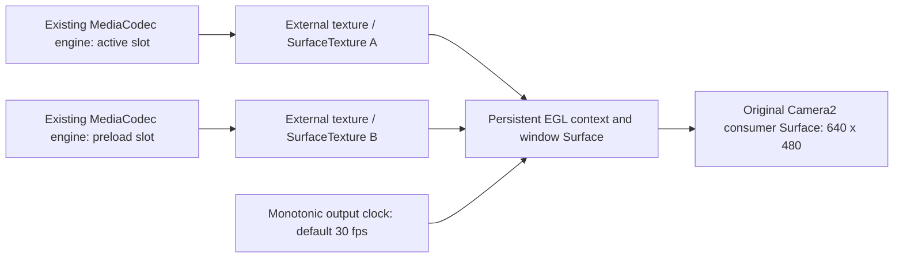

# Phase 3 pipeline

`HookEntry` composes `StableFrameProvider` with the existing scoped Camera2 bridge. The independent consumer still has no dependency on the engine or bridge. The pipeline does not create an additional consumer preview.

`LoopingMp4Provider` remains the only decoder implementation. Its preload option pauses after releasing the first video frame. A slot is eligible for selection only after the EGL thread receives `onFrameAvailable`, calls `updateTexImage`, and obtains its transform/timestamp. Once selected, the same decoder resumes. Creating/configuring/releasing MediaCodec happens on decoder worker threads; decoder retirement never blocks the EGL output thread. Texture deletion is queued back to the EGL owner only after the decoder has stopped producing.

`switchNow(uri)` prepares a pending slot and commits after its first valid frame has been latched. `switchAfterCurrent(uri)` also waits for the active decoder's output EOS/loop event. The active texture remains visible while preparation is pending; requests supersede a previous pending request explicitly. A failed preload is logged and disposed while the active slot continues. The consumer Surface, EGL context and EGL window are retained across all source switches. They are released when that consumer Surface lifecycle ends.

The renderer draws a full-screen external-OES quad, applies the SurfaceTexture transform, calls `eglPresentationTimeANDROID`, and swaps buffers at the configured cadence. `StableFrameProvider(context, targetFps)` defaults to 30 and accepts 1–60 fps. Phase 3 tested 640×480. Phase 4 queries the EGL window extent for its viewport and also verifies a 1920×1080 own-consumer Surface; source content stretches to fill this target. A 15 fps source therefore deliberately repeats frames at 30 fps. No black clear buffer is submitted while waiting for the first source frame or during transitions.

Output presentation time uses `System.nanoTime()` and is clamped above the previous output time. Source PTS and input SurfaceTexture timestamps are logged separately and may reset on loop/switch; they never drive the output presentation clock. Missed scheduled renderer ticks are counted rather than sending a burst of catch-up buffers. The last valid source frame is drawn on ticks without a new source image, with a cumulative repeat count. Coalesced source callbacks and output/consumer count differences are recorded but are not exact HAL drop counters.

Diagnostics are written in the consumer process under `Android/data/co.sarae.camera.consumer/files/phase3/bridge-PID.jsonl` and `consumer-PID.jsonl`. Every received consumer frame is sampled for the known red/blue test pattern and black pixels. Files include source arrival/latch, decoder creation/release, switch events, EGL creation/release, output PTS and gap, consumer timestamp/gap and Camera2 generation. Java/native diagnostics are captured separately through ADB.

The active switching/endurance acceptance window excludes background lifecycle changes. The consumer explicitly closes its camera onStop because TextureView may retain its Surface while backgrounded. Foregrounding then needs a new Surface wrapper/session and provider. EGL context loss or an invalid output Surface is a pipeline error; the prototype releases its resources and requires a new provider rather than claiming transparent recovery. Multi-output Camera2, still capture, ImageReader consumer output and third-party consumers remain outside the verified scope.

Platform references: [SurfaceTexture ownership and updateTexImage](https://developer.android.com/reference/android/graphics/SurfaceTexture), [EGL presentation timestamps](https://developer.android.com/reference/android/opengl/EGLExt), [MediaCodec](https://developer.android.com/reference/android/media/MediaCodec).
