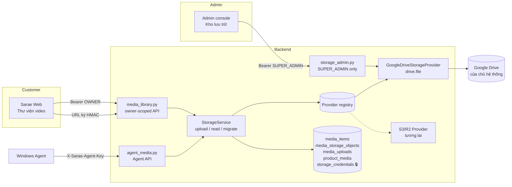
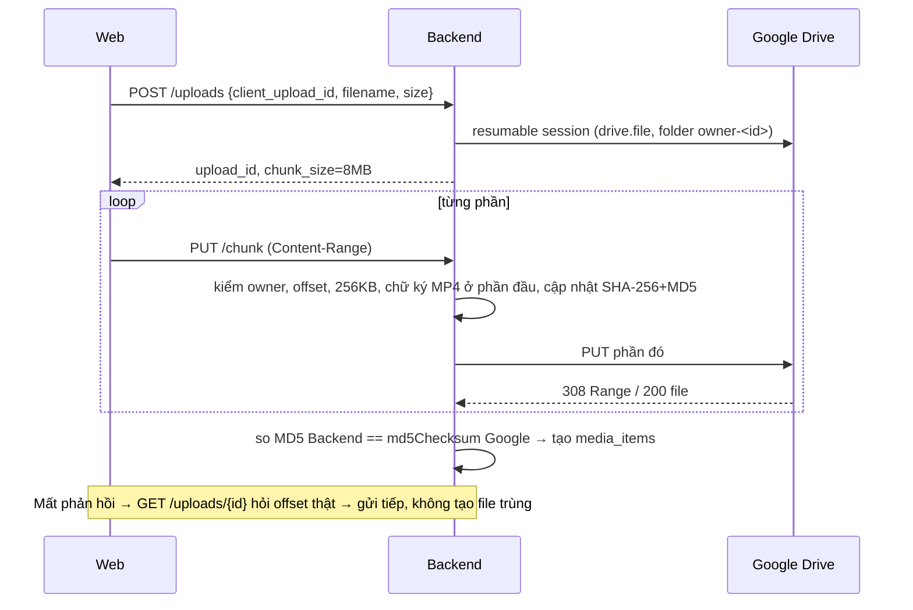

# Centralized Media Storage — Media Library tập trung

> Nhánh: `feature/google-drive-media` · Ngày: 2026-10-21 · Nguồn: Change Request "Centralized Storage cho Tools Sarae".
> Trạng thái: **đã code + test tự động với Google giả lập**. **Chưa** chạy với Google Drive thật của chủ hệ thống, **chưa** tích hợp Agent cache / LIVE readiness (Phase 3–4).

## 1. Kiến trúc



| Nguyên tắc | Cách làm |
|---|---|
| Storage thuộc hệ thống | Bảng `storage_credentials` (1 dòng/provider). Chỉ SUPER_ADMIN kết nối/ngắt |
| Media thuộc User | Mọi dòng có `owner_id`; mọi truy vấn lọc theo owner, sai owner → 404 |
| Không lộ kho cho khách | Response không có provider file ID, folder ID, URL Drive, token |
| Phân quyền ở Backend | Thư mục `owner-<id>` chỉ để sắp xếp; quyền đọc/ghi luôn kiểm tra trong DB |
| Đổi provider được | `StorageProvider` (ABC) + registry; Media ID của Sarae không đổi khi đổi kho |
| Dữ liệu cũ | Không đụng `agent_media`, `product_live_videos`, `video_tags` (= LOCAL_LEGACY) |

### Bố cục trong Google Drive (chỉ để tổ chức)

```
Sarae Media Storage/            appProperties: sarae_role=root
  owner-<owner_id>/             appProperties: sarae_owner=<owner_id>
    <media_id>.mp4              appProperties: sarae_media, sarae_owner
```
Tên file trên Drive là Media ID, **không** dùng tên file của khách.

## 2. Mô hình dữ liệu (migration `20261021_0012`, chỉ thêm bảng)

| Bảng | Vai trò |
|---|---|
| `storage_credentials` | Credential hệ thống theo provider; refresh/access token **mã hóa Fernet** |
| `storage_oauth_states` | State OAuth admin: lưu hash, dùng 1 lần, hết hạn 10 phút, PKCE verifier mã hóa |
| `storage_owner_containers` | Folder/prefix của từng owner trong mỗi provider |
| `media_items` | Video: `id` (Sarae), `owner_id`, `provider`, `provider_file_id`, metadata, `sha256`, `md5`, `status` |
| `media_storage_objects` | Lịch sử bản lưu: ACTIVE / COPYING / RETIRED / FAILED (phục vụ migrate) |
| `media_uploads` | Phiên upload resumable; `client_upload_id` chống tạo trùng; session provider mã hóa |
| `product_media` | Product ↔ Video N:N có thứ tự, **không** gắn Agent |
| `media_thumbnails` | Ảnh bìa (khung hình do trình duyệt chụp, ≤ 512 KB) — migration `20261022_0013` |
| `media_item_presenters` | Video ↔ Người giới thiệu N:N — migration `20261022_0013` |

Rollback: `alembic downgrade 20261018_0011` chỉ xóa 7 bảng mới (**mất metadata media mới** → backup DB trước). Đã thử upgrade → downgrade → upgrade trên DB tạm.

## 3. API

| Method | Path | Ai gọi | Ghi chú |
|---|---|---|---|
| GET | `/api/storage-admin/status` | SUPER_ADMIN | Trạng thái kho, tài khoản, số video |
| POST | `/api/storage-admin/google/authorize` | SUPER_ADMIN | Trả URL consent (state + PKCE) |
| GET | `/api/storage-admin/google/callback` | Google (trình duyệt admin) | Redirect về `#/admin/storage?storage=connected` hoặc `storage_error=<CODE>` |
| POST | `/api/storage-admin/google/check` | SUPER_ADMIN | Refresh token, đọc tài khoản + quota |
| DELETE | `/api/storage-admin/google/connection` | SUPER_ADMIN | Revoke ở Google, xóa token; file vẫn còn |
| POST | `/api/storage-admin/migrations` | SUPER_ADMIN | Copy → kiểm SHA-256 → đổi mapping |
| POST | `/api/media-library/uploads` | OWNER | Tạo phiên upload (idempotent theo `client_upload_id`) |
| GET | `/api/media-library/uploads/{id}` | OWNER | Offset thật của kho (resume) |
| PUT | `/api/media-library/uploads/{id}/chunk` | OWNER | `Content-Range: bytes s-e/total`, tối đa 32 MB/phần, bội số 256 KB |
| DELETE | `/api/media-library/uploads/{id}` | OWNER | Hủy phiên ở kho |
| GET | `/api/media-library` | OWNER | Lọc `q`, `product_id`, `status` |
| GET/PATCH/DELETE | `/api/media-library/{id}` | OWNER | PATCH chỉ sửa tên hiển thị/ghi chú/tags; DELETE = ẩn (soft) |
| GET | `/api/media-library/{id}/stream` | URL ký | Proxy có HTTP Range (206) |
| GET | `/api/media-library/{id}/thumbnail` | URL ký | Ảnh xem trước |
| PUT | `/api/media-library/{id}/products` | OWNER | Gắn video vào nhiều sản phẩm |
| GET/PUT | `/api/products/{id}/videos` | OWNER | Danh sách video có thứ tự của sản phẩm |
| PUT | `/api/media-library/{id}/thumbnail` | OWNER | Ảnh bìa JPEG/PNG/WebP; kèm `duration_seconds/width/height` chỉ điền khi kho chưa có |
| PUT | `/api/media-library/{id}/presenters` | OWNER | Gắn người giới thiệu (lọc danh sách bằng `presenter_id`) |
| GET | `/api/agent-media/manifest?agent_id&session_id` | Agent | Mọi video AVAILABLE của sản phẩm trong phiên + sha256/md5/size |
| GET | `/api/agent-media/{id}/content?agent_id` | Agent | Tải qua Backend, có Range để resume |

Lỗi có mã ổn định ở header `X-Sarae-Error` (ví dụ `STORAGE_NOT_CONNECTED`, `STORAGE_TOKEN_REVOKED`, `UPLOAD_OFFSET_MISMATCH`, `MEDIA_NOT_FOUND`). Lỗi kho **không bao giờ trả 401**, vì 401 sẽ làm Web tự đăng xuất khách.

## 4. Luồng upload



## 5. Migrate sang S3/R2 (khi có provider)

1. Viết `S3StorageProvider(StorageProvider)` rồi `register("S3", ...)`.
2. Đặt `SARAE_STORAGE_PROVIDER=S3` để **upload mới** vào S3; media cũ vẫn đọc từ Drive.
3. Gọi `POST /api/storage-admin/migrations {target_provider:"S3", limit}` theo từng lô: copy dạng stream → đọc lại bản sao, so SHA-256 → chỉ khi khớp mới đổi `media_items.provider/provider_file_id`; bản Drive chuyển RETIRED (không xóa).
4. Muốn rollback một media thì chỉ cần đổi mapping về object RETIRED.

Đã kiểm thử với provider in-memory (`tests/memory_storage.py`): migrate thành công, checksum sai thì giữ nguyên mapping cũ và xóa bản sao lỗi.

## 6. Kiểm thử

| Bộ | Kết quả | Ghi chú |
|---|---|---|
| `tests/test_media_library.py` | **29/29 PASS** | Google giả lập (`tests/fake_google_drive.py`) |
| Toàn bộ backend `python -m unittest discover -s tests` | **177/177 PASS** | Gồm test LIVE, Agent, owner isolation cũ |
| Alembic upgrade/downgrade/upgrade | PASS | DB tạm |
| Web `tsc -b` + `vite build` | PASS | Chạy trên bản sao tạm, có junction tới `node_modules`/`vendor` của checkout chính |
| Google Drive thật | **CHƯA CHẠY** | Cần OAuth client + tài khoản Drive của chủ hệ thống |

Những gì test bao phủ: chỉ admin kết nối được, state giả/dùng lại/hết hạn, từ chối consent, thiếu scope, refresh và revoke token, ngắt kết nối rồi kết nối lại, chặn đổi sang tài khoản Google khác, upload nhiều phần, retry không tạo trùng, resume theo offset thật, giới hạn dung lượng/loại file/quota, file không phải video, hủy upload, phát hiện hỏng dữ liệu bằng MD5, cô lập owner (list/get/patch/delete/upload/product), stream có Range + chữ ký + hết hạn, sửa metadata không đổi file trên kho, Product–Video N:N có thứ tự, 2 Agent của cùng User dùng chung thư viện, Agent/khóa của User khác bị từ chối, phiên đã gán cho Agent khác bị từ chối, migrate provider, upload mới sang provider khác, LOCAL_LEGACY không đổi.

## 7. Chưa làm / còn mở

| Hạng mục | Trạng thái |
|---|---|
| Agent tải cache theo manifest, kiểm tra checksum, READY | Phase 3 (API phía Cloud đã sẵn) |
| Khóa bắt đầu LIVE khi chưa đủ cache | Phase 4, chưa đổi LIVE Session |
| Dọn object RETIRED / media DELETED khỏi kho | Chưa có job; hiện giữ lại để an toàn |
| Chuyển dữ liệu LOCAL_LEGACY lên kho | Chưa làm; cần cơ chế và xác nhận của User |
| Upload lên thẳng kho (không đi qua Backend) | Không làm: phiên resumable của Drive là URL có quyền ghi, không đưa cho trình duyệt |
| Duration/độ phân giải | Lấy từ Google sau khi Drive xử lý xong video; tự cập nhật khi mở chi tiết |
| SHA-256 khi Backend khởi động lại giữa lúc upload | Bỏ trống; dùng MD5 của Google; SHA-256 được tính lại khi migrate |

## 8. Giao diện Thư viện video (cập nhật 2026-10-22)

| Vấn đề người dùng báo | Cách xử lý |
|---|---|
| Đổi trang thì mất trạng thái upload | Hàng đợi upload nằm ngoài React (`web/src/uploadStore.ts`), ô tiến trình nổi (`UploadDock`) hiện ở mọi trang; tải lại trang thì chọn lại đúng file để tải tiếp |
| Không có thumbnail | Trình duyệt chụp khung hình từ file trước khi upload và lưu làm ảnh bìa; video cũ tự tạo ảnh bìa nền; có nút "Đặt khung hình đang xem làm ảnh bìa" |
| Bố cục chưa đẹp | Card dọc 9:16, thanh tóm tắt + nút tải lên, kéo-thả toàn trang, bộ lọc sản phẩm/người/chưa gắn, sắp xếp |
| Gán sản phẩm khó khi danh sách dài, thiếu người giới thiệu | Panel chi tiết 2 cột, tab Thông tin / Sản phẩm / Người giới thiệu với danh sách tìm kiếm (không dấu), ảnh, "Đã chọn" |
| "Video trên Agent (cũ)" | Giữ lại vì LIVE vẫn phát từ video trên Agent; chuyển xuống nhóm menu "AGENT · CÁCH CŨ" cùng 2 trang liên quan, gỡ sau Phase 3–4 |
| Khối "Video theo sản phẩm" khó hiểu | Bỏ khỏi trang thư viện; gán sản phẩm làm trong chi tiết video. Thứ tự phát theo sản phẩm sẽ làm cùng tích hợp LIVE |
