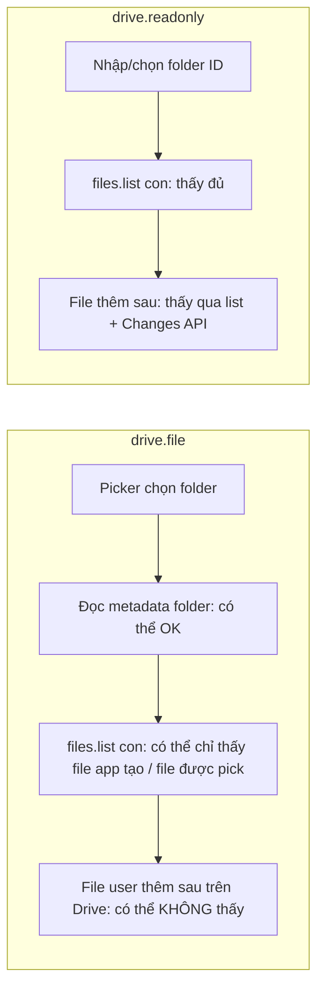
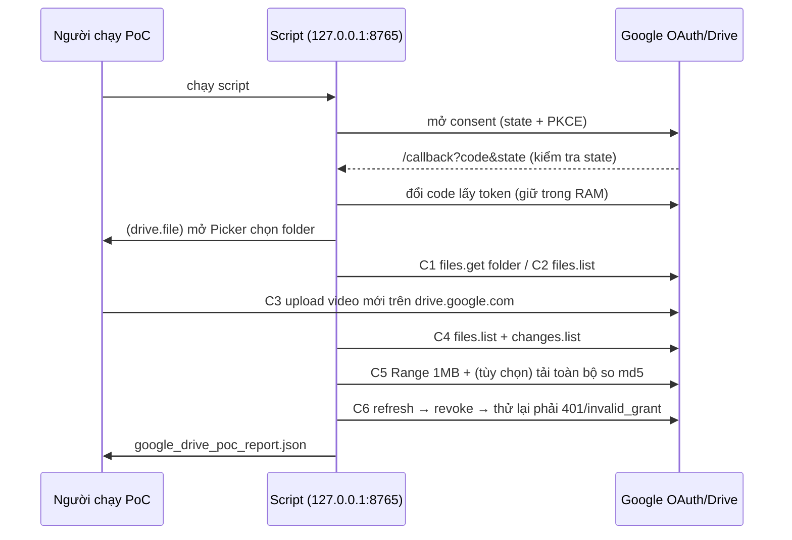

# Google Drive OAuth PoC — Phase 1

> Ngày: 2026-10-21 · Nhánh: `dev` · Trạng thái: **PoC CHƯA CHẠY với tài khoản Google thật** → Phase 2 chưa được bắt đầu.
> Quy ước giống Business Spec: **ĐÃ XÁC MINH** / **TÀI LIỆU GOOGLE** / **GIẢ THUYẾT (chưa kiểm chứng)**.

## 1. Câu hỏi PoC phải trả lời

| Mã | Kiểm tra | Vì sao quan trọng |
|---|---|---|
| C1 | User chọn folder đã có sẵn video, Sarae đọc được metadata folder | Thêm folder vào Sarae |
| C2 | Liệt kê đủ file có sẵn trong folder | Media Library ban đầu |
| C3 | User thêm file **trực tiếp trên drive.google.com** | Luồng làm việc thực tế |
| C4 | Sarae thấy file mới (files.list + Changes API) | Đồng bộ tự động |
| C5 | Tải file private (HTTP Range + md5 toàn file) | Preview Web + cache Agent |
| C6 | Refresh token hoạt động; sau khi revoke thì bị từ chối | Xử lý hết hạn/thu hồi |

## 2. Phân tích OAuth scope (TÀI LIỆU GOOGLE)

| Scope | Mức độ | Quyền | Verification khi app public |
|---|---|---|---|
| `drive.file` | Non-sensitive | Chỉ file do app tạo hoặc user mở/chọn qua Google Picker | Brand verification cơ bản |
| `drive.readonly` | **Restricted** | Xem + tải **mọi** file của tài khoản | Restricted-scope verification + **đánh giá bảo mật CASA hằng năm** (bên thứ ba, có phí) |
| `drive.metadata.readonly` | **Restricted** | Chỉ metadata (không tải nội dung) | Như trên — không giải quyết được nhu cầu tải video |
| `drive` | **Restricted** | Toàn quyền | Như trên — rộng hơn mức cần |

Nguồn: [Choose Google Drive API scopes](https://developers.google.com/workspace/drive/api/guides/api-specific-auth), [Google Picker overview](https://developers.google.com/workspace/drive/picker/guides/overview).

Điểm tài liệu Google **không** khẳng định: chọn một **folder** qua Picker với `drive.file` có cấp quyền cho file con (có sẵn và thêm sau) hay không. Trang scope chỉ mô tả quyền theo từng file.

### Giả thuyết (CHƯA KIỂM CHỨNG — PoC sẽ xác nhận)



| Yêu cầu nghiệp vụ | `drive.file` (dự đoán) | `drive.readonly` + `drive.file` (dự đoán) |
|---|---|---|
| C1 chọn folder | ✅ qua Picker | ✅ |
| C2 thấy file có sẵn | ⚠️ có thể chỉ thấy file được pick riêng | ✅ |
| C4 file mới thêm trên Drive | ❌ có thể phải pick lại thủ công | ✅ |
| C5 tải file private | ✅ với file có quyền | ✅ |
| Upload từ Sarae | ✅ | ✅ (dùng `drive.file`) |
| Verification | Nhẹ | Nặng: restricted + CASA |
| Chế độ "Testing" | Refresh token có thể hết hạn sau 7 ngày, tối đa 100 test user | Như bên trái |

## 3. Phát hiện cần chủ dự án quyết định

1. **Picker cần access token ở trình duyệt.** Google Picker bắt buộc `setOAuthToken(...)` phía browser. Điều này mâu thuẫn với yêu cầu "không đưa access token ra frontend" nếu chọn `drive.file`.
   - Đề xuất giảm thiểu: Backend cấp access token ngắn hạn (~1 giờ), chỉ scope `drive.file`, chỉ cho trang chọn folder, **không bao giờ** gửi refresh token. Cần chủ dự án chấp thuận ngoại lệ này.
   - Với `drive.readonly`, có thể không cần Picker: Backend tự liệt kê folder cho Web hiển thị.
2. **Restricted scope** (`drive.readonly`) cần quy trình verification của Google + CASA trước khi mở cho user ngoài danh sách test. Ảnh hưởng thời gian và chi phí ra mắt.
3. **App ở chế độ Testing (External)**: refresh token hết hạn sau 7 ngày (theo chính sách Google đã biết; cần kiểm tra lại trong Console của dự án). Nếu dự án dùng Google Workspace "Internal" thì không bị giới hạn này, nhưng chỉ user trong tổ chức dùng được.

## 4. Cách chạy PoC (cần người có tài khoản Google)

Script: [`backend/tools/google_drive_oauth_poc.py`](../backend/tools/google_drive_oauth_poc.py) — độc lập, không đụng DB Sarae, không in/ghi token.



Chuẩn bị trong Google Cloud Console:
1. Bật **Google Drive API** và **Google Picker API**.
2. OAuth consent screen: thêm tài khoản thử làm **Test user**.
3. Tạo OAuth client **Web application**: redirect URI `http://127.0.0.1:8765/callback`, JS origin `http://127.0.0.1:8765`.
4. Tạo **API key** (giới hạn cho Picker API) và lấy **Project number**.
5. Chuẩn bị một folder có sẵn ≥ 2 video (ghi lại số item đang thấy trên Drive).

Chạy (PowerShell, từ `backend/`):

```powershell
$env:GOOGLE_OAUTH_CLIENT_ID="..."; $env:GOOGLE_OAUTH_CLIENT_SECRET="..."
$env:GOOGLE_PICKER_API_KEY="..."; $env:GOOGLE_CLOUD_PROJECT_NUMBER="..."
# Lần 1: scope hẹp drive.file
.venv\Scripts\python.exe tools\google_drive_oauth_poc.py --scope file --expected-count 3 --full-download --report google_drive_poc_report_file.json
# Lần 2: scope restricted drive.readonly (folder ID lấy từ URL folder)
.venv\Scripts\python.exe tools\google_drive_oauth_poc.py --scope readonly --folder-id <ID> --expected-count 3 --full-download --report google_drive_poc_report_readonly.json
```

Gửi lại 2 file report JSON (đã bị `.gitignore`, chỉ chứa tên file/ID, không có token).

## 5. Kết quả

| Kiểm tra | `drive.file` | `drive.readonly` |
|---|---|---|
| C1–C6 | **CHƯA CHẠY** | **CHƯA CHẠY** |

Đã chạy: 6 unit test offline cho helper của script (PKCE S256, so khớp `state`, URL authorize offline, escape query, diff, che token) — **PASS**. Các test này **không** chứng minh PoC Google thành công.

## 6. Hiện trạng code liên quan (để chuẩn bị Phase 2)

| Thành phần | Hiện tại | Tác động Phase 2 |
|---|---|---|
| `agent_media` (agent_library.py) | Video theo **Agent**, `media_id = sha256(path local)`, không có `owner_id` | Giữ nguyên = `LOCAL_LEGACY` |
| `product_live_videos` (product_videos.py) | Có `agent_id`, unique `(product, agent, media)` | Bảng mới product↔media **không** có agent |
| Command Router (cloud_agents.py `create_command`) | Long-poll + ACK, lane live/background | Thêm kind `media.prepare_cache` (lane background) |
| agent-core `MediaLibrary.resolve` | Chỉ phát file trong folder được phép | Thêm nguồn `media-cache/` |
| credentials.py | Fernet, theo owner | Tái dùng để mã hóa refresh token Google |
| Alembic head | `20261018_0011` | Migration mới chỉ thêm bảng |
