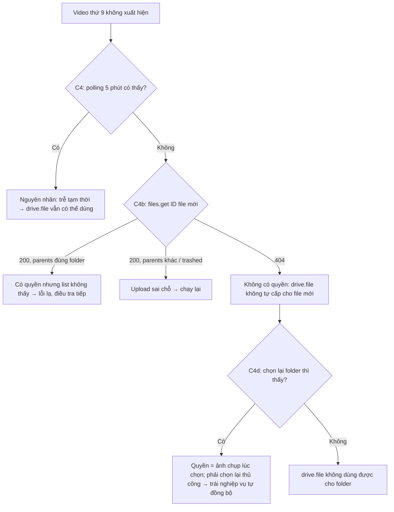
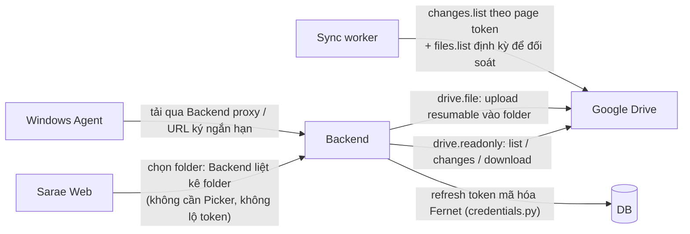

# Google Drive OAuth PoC — Phase 1

> Cập nhật: 2026-10-21 · Nhánh: `dev` · Trạng thái: **`drive.file` đã chạy 1 lần thật (C4 FAIL)**; PoC bổ sung và phép thử `drive.readonly` **chưa chạy**. Phase 2 **chưa bắt đầu**.
> Quy ước: **THỰC NGHIỆM** = quan sát từ report PoC thật · **TÀI LIỆU GOOGLE** = trích tài liệu chính thức · **NGUỒN CỘNG ĐỒNG** = forum/issue · **SUY LUẬN** = chưa kiểm chứng.

Nghiệp vụ đã chốt, PoC **không** được thay đổi:
- User chọn nhiều folder **có sẵn**.
- Video user thêm **trực tiếp trên Google Drive** phải **tự đồng bộ**.
- Agent cache video trước khi LIVE.

## 1. Các kiểm tra trong PoC

| Mã | Kiểm tra |
|---|---|
| C1 | Chọn folder có sẵn video và đọc được metadata của folder |
| C2 | Liệt kê đủ file có sẵn trong folder |
| C3 | User upload file mới trực tiếp trên drive.google.com (người chạy xác nhận) |
| C4 | `files.list` thấy file mới — **polling** trong `--poll-seconds` (mặc định 300s, cách nhau 15s) |
| C2b | `files.get` thẳng vào file đã thêm ở lần chạy trước (`--probe-file-id`) |
| C4b | Gọi `files.get` thẳng vào ID file mới: 200 = đọc được, 404 = không có quyền |
| C4c | Changes API (`changes.list` từ page token lấy **trước** khi upload) có báo file mới không |
| C4d | (chỉ `drive.file` + `--repick`) Chọn lại cùng folder bằng Picker thì có thấy file mới không |
| C5 | Tải file private: Range 1 MB, rồi tải hết và so md5 |
| C6a/b | Refresh token hoạt động; sau khi thu hồi quyền thì bị từ chối (401 / `invalid_grant`) |

## 2. THỰC NGHIỆM — lần chạy 1, `drive.file` (15:07–15:10, 2026-10-21)

Folder `Tiktok App`, ID `1B0BJwMNZJ7SXnj2en0IeLvgSbdQ6VBBr`.

| Mã | Kết quả | Số liệu từ report |
|---|---|---|
| C1 | ✅ PASS | Picker chọn được folder; `files.get` folder trả 200 |
| C2 | ✅ thực chất PASS | `items_visible=8`, `videos_visible=8`, khớp 8 video user thấy trên Drive. Report ghi FAIL **chỉ vì** lúc chạy truyền `--expected-count 2` |
| C3 | ✅ | User xác nhận đã upload xong video thứ 9 rồi mới nhấn Enter |
| C4 | ❌ FAIL | `list_delta.added=[]`. Danh sách vẫn 8 file. Lần này chỉ list **1 lần**, không polling |
| C4c | ❌ | `changes_api_hits_in_folder=[]` (lần 1 chưa ghi tổng số change) |
| C5 | ✅ PASS | HTTP 206 `bytes 0-1048575/5080944`; tải hết 5 080 944 byte, md5 khớp |
| C6a | ✅ PASS | Refresh trả 200 |
| C6b | ✅ PASS | Revoke 200; Drive sau revoke 401; refresh sau revoke 400 `invalid_grant` |

Ghi nhận thêm từ thực nghiệm:
- Danh sách 8 file gồm cả `.mov` (`video/quicktime`) và `.mp4`.
- **Khác với một số nguồn cộng đồng**: chọn folder qua Picker với `drive.file` **có** cho đọc 8 file **có sẵn** trong folder.

## 3. Phân tích nguyên nhân C4

| Giả thuyết | Bằng chứng | Đánh giá |
|---|---|---|
| Script lọc mất file mới | Query chỉ là `'<folder>' in parents and trashed = false`, không lọc MIME. `added` so trên **toàn bộ** item, không chỉ video (THỰC NGHIỆM + code) | ❌ Loại trừ |
| File mới ở folder khác / đang trong thùng rác | Người chạy xác nhận upload vào đúng folder; chưa có ID file để đối chiếu | ⚠️ Chưa loại trừ → **C4b** sẽ kiểm tra `parents` / `trashed` (cần quyền đọc) |
| Trễ đồng bộ tạm thời của Drive | Chỉ list 1 lần ngay sau Enter | ⚠️ Chưa loại trừ → **C4** polling 5 phút |
| `drive.file` chỉ cấp quyền cho **ảnh chụp** các file có trong folder **lúc chọn**; file thêm sau không được cấp | Changes API cũng không thấy. Changes API chỉ trả về file mà token có quyền (SUY LUẬN). Khớp với mô tả quyền theo từng file của `drive.file` (TÀI LIỆU GOOGLE) | 🔶 **Khả năng cao nhất**, cần C4b = 404 sau polling để xác nhận |



### TÀI LIỆU GOOGLE (không phải thực nghiệm)
- `drive.file` (non-sensitive): quyền với file app tạo, hoặc file user mở/chia sẻ cho app qua Google Picker. Tài liệu **không** nói gì về quyền với file con của folder, kể cả file có sẵn hay file thêm sau. [Nguồn](https://developers.google.com/workspace/drive/api/guides/api-specific-auth)
- `drive.readonly` (**restricted**): xem và tải mọi file. Muốn phát hành công khai phải qua restricted-scope verification, kèm đánh giá bảo mật **CASA** hằng năm.
- `drive.metadata.readonly` cũng là restricted, và không tải được nội dung → không giải quyết được bài toán.
- Picker trên Web bắt buộc trình duyệt giữ access token (`setOAuthToken`). [Nguồn](https://developers.google.com/workspace/drive/picker/guides/overview)

### NGUỒN CỘNG ĐỒNG (độ tin cậy thấp)
- Có nguồn nói chọn folder **không** cho đọc nội dung. THỰC NGHIỆM của chúng ta **mâu thuẫn** với điều này (vẫn đọc được 8 file có sẵn). [Uppy PR #6385](https://github.com/transloadit/uppy/pull/6385)
- Không nguồn nào kiểm chứng trường hợp file thêm sau. [storydump #1165](https://github.com/chrisrogers37/storydump/issues/1165)

## 4. PoC bổ sung — cách chạy (CHƯA CHẠY)

Chạy từ `backend/`, đặt 4 biến môi trường như lần trước.

### Lần A — `drive.file`: loại trừ độ trễ, kiểm tra quyền và việc chọn lại folder

```powershell
.venv\Scripts\python.exe tools\google_drive_oauth_poc.py --scope file `
  --expected-count 9 --probe-file-id "<link video thứ 9>" `
  --poll-seconds 300 --poll-interval 15 --repick --full-download `
  --report google_drive_poc_report_file_2.json
```

1. Chọn folder `Tiktok App` → kiểm tra một lần chọn **mới** có thấy cả video 9 hay không (C2 = 9?), và `files.get` video 9 (C2b).
2. Upload **video thứ 10** trên Drive → nhấn Enter → dán link video 10 → script polling 5 phút (C4) → probe (C4b) → Changes API (C4c).
3. Script mở Picker lần nữa → chọn lại **đúng folder đó** (C4d).

### Lần B — `drive.readonly` trên cùng folder

Chuẩn bị: Google Cloud Console → *Google Auth Platform → Data access* → thêm scope `.../auth/drive.readonly`. Vì app chưa xác minh, khi consent Google sẽ hiện cảnh báo *“Google hasn't verified this app”* với test user → bấm *Advanced → Go to …* (chỉ áp dụng với tài khoản test).

```powershell
.venv\Scripts\python.exe tools\google_drive_oauth_poc.py --scope readonly `
  --folder-id 1B0BJwMNZJ7SXnj2en0IeLvgSbdQ6VBBr --expected-count 10 `
  --probe-file-id "<link video thứ 9>" --poll-seconds 300 --poll-interval 15 --full-download `
  --report google_drive_poc_report_readonly.json
```

- `--expected-count`: điền đúng số video đang có trên Drive lúc chạy (10 nếu lần A đã thêm video 10).
- Khi được hỏi, upload **video thứ 11** → dán link → C4/C4b/C4c.

### Tiêu chí đánh giá

| Kết quả | Kết luận |
|---|---|
| A: C4 PASS sau polling | Lần 1 chỉ là trễ → giữ `drive.file` |
| A: C4 FAIL + C4b 404 + C4d PASS | `drive.file` chỉ cấp quyền theo ảnh chụp lúc chọn → **không đạt** yêu cầu tự đồng bộ |
| B: C2 = đủ, C4 PASS, C4c thấy file | `drive.readonly` đáp ứng nghiệp vụ |

## 5. Đề xuất kiến trúc (SƠ BỘ — chốt sau khi có kết quả lần A/B)

Nếu kết quả là **A không đạt, B đạt** (dự đoán, chưa xác nhận):



| Phương án | Đáp ứng "file thêm trên Drive tự đồng bộ" | Token ở browser | Chi phí phát hành |
|---|---|---|---|
| P1: `drive.readonly` + `drive.file` | ✅ (nếu lần B PASS) | Không cần | Restricted verification + CASA hằng năm |
| P2: chỉ `drive.file` + Picker | ❌ nếu C4 FAIL thật — user phải chọn lại folder | Access token ngắn hạn | Nhẹ |
| P3: `drive.file`, bắt buộc upload qua Sarae | ❌ trái nghiệp vụ đã chốt | Access token ngắn hạn | Nhẹ |
| P4: Workspace Internal app | ✅ với `drive.readonly`, không cần CASA | Không cần | Chỉ dùng được cho user **trong cùng tổ chức** Workspace — không hợp SaaS |

Khuyến nghị tạm thời: **P1** nếu lần B PASS. Trước khi phát hành công khai phải có lộ trình verification/CASA. Trong thời gian dev/test vẫn chạy được ở chế độ Testing (tối đa 100 test user; refresh token có thể hết hạn sau 7 ngày — cần kiểm tra trong Console).

## 6. Test tự động (offline)

`python -m unittest tests.test_google_drive_poc` — 9 test: PKCE, `state`, URL authorize, escape query, diff, đọc ID từ link Drive, che token, và luồng C4/C4b/C4c/C4d với Drive giả (polling chấp nhận độ trễ; không thấy file → FAIL + ghi 404). Các test này **không** thay cho kết quả thật từ Google.

## 7. Hiện trạng code liên quan (chuẩn bị Phase 2)

| Thành phần | Hiện tại | Tác động Phase 2 |
|---|---|---|
| `agent_media` (agent_library.py) | Video theo **Agent**, `media_id = sha256(path local)`, không có `owner_id` | Giữ nguyên, coi là `LOCAL_LEGACY` |
| `product_live_videos` (product_videos.py) | Có `agent_id`, unique `(product, agent, media)` | Bảng mới product↔media **không** có agent |
| Command Router (cloud_agents.py `create_command`) | Long-poll + ACK, lane live/background | Thêm kind `media.prepare_cache` |
| agent-core `MediaLibrary.resolve` | Chỉ phát file trong folder được phép | Thêm nguồn `media-cache/` |
| credentials.py | Fernet, theo owner | Tái dùng để mã hóa refresh token |
| Alembic head | `20261018_0011` | Migration mới chỉ thêm bảng (additive) |
