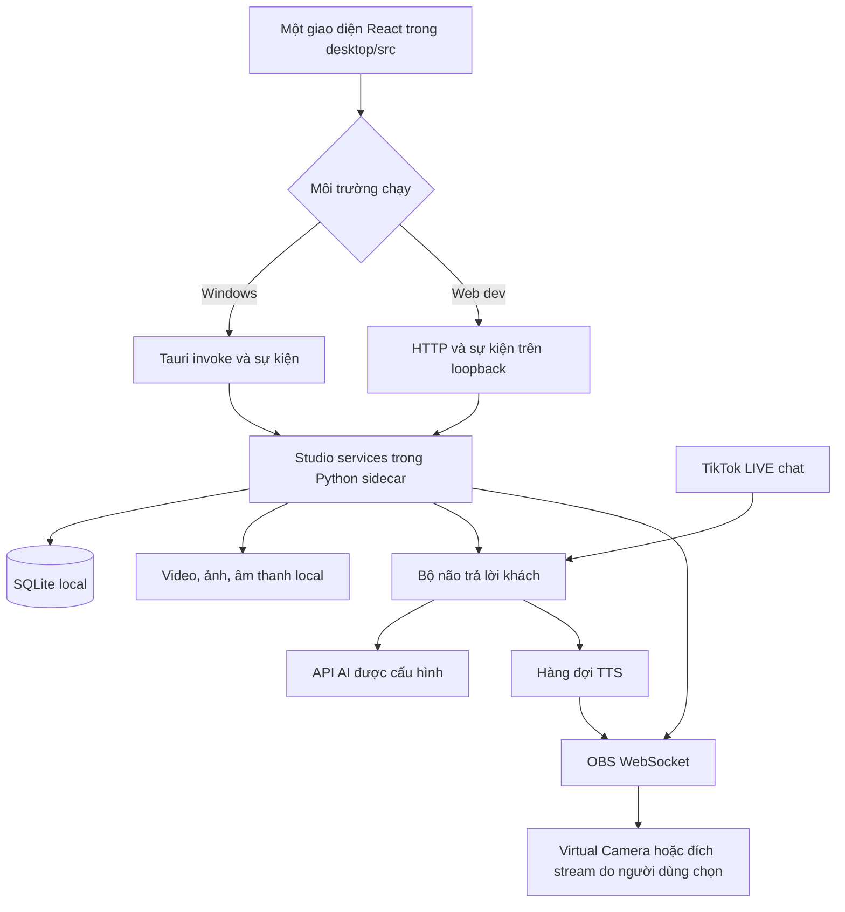

# Tổng quan Sarae Live Studio chạy local trên Windows

Ngày chốt yêu cầu: 26/11/2026. Trạng thái: thiết kế để triển khai tiếp trên máy khác; nhánh bàn giao chỉ bổ sung tài liệu, chưa chuyển đổi ứng dụng.

**Cập nhật 26/11/2026:** luồng nền đầu tiên đã được triển khai ở phiên bản `0.3.0`; xem [trạng thái thực tế và hướng dẫn chạy](LOCAL_TAURI_STUDIO_STATUS.md). Tài liệu này tiếp tục mô tả kiến trúc đích cho toàn bộ các giai đoạn, không phải danh sách tính năng đã hoàn thành.

Sarae Live Studio sẽ trở thành một ứng dụng Windows dùng Tauri 2, mở thẳng vào studio, quản lý dữ liệu và video trên máy. Một bộ giao diện React phục vụ cả cửa sổ Tauri lẫn chế độ chạy thử bằng trình duyệt. Bộ não trả lời khách được tích hợp vào runtime local và được phép gọi API AI bên ngoài.

## 1. Yêu cầu đã thống nhất

| Nội dung | Hướng triển khai |
| --- | --- |
| Sản phẩm chính | Một ứng dụng Windows Tauri, dùng để chuẩn bị và vận hành LIVE trên máy đang chạy OBS. |
| Chạy thử trên web | Dùng cùng mã giao diện và cùng nghiệp vụ; trình duyệt là chế độ phát triển/kiểm thử. |
| Đăng nhập Sarae | Bỏ đăng nhập, tài khoản OWNER/SUPER_ADMIN, license, mã kích hoạt và bước chọn Windows Agent khỏi luồng ứng dụng local. |
| Dữ liệu | Sản phẩm, hỏi đáp, kịch bản, phiên LIVE, timeline, cấu hình và lịch sử lưu local. |
| Video và âm thanh | Đọc hoặc nhập file local; không upload lên R2, Google Drive hay kho video Sarae. |
| AI | Được gọi API AI; key và cấu hình do người dùng thiết lập trên máy. Có thể bổ sung model local sau. |
| Trả lời khách | Có ngữ cảnh sản phẩm, hỏi đáp của shop, lịch sử hội thoại, chống trả lời trùng và hàng đợi giọng đọc. |
| Truyền hình và tiếng | Kết nối OBS ở máy local; học cách tổ chức stream và phản hồi từ repo AI khi phù hợp. |
| Repo chính | Phát triển trên nhánh mới tách từ `PhucDev-IT/sarae_live_studio`, nhánh gốc `dev`. |
| Repo AI | Nguồn tham khảo, không phải yêu cầu chuyển toàn bộ ứng dụng AI/avatar sang repo chính. |

“Local” ở đây nghĩa là dữ liệu nghiệp vụ và media do máy người dùng sở hữu. TikTok, nhà cung cấp AI, TTS online nếu được chọn, và đích livestream vẫn cần mạng. Câu hỏi cùng phần ngữ cảnh cần thiết sẽ được gửi tới nhà cung cấp AI; không gửi video nếu tính năng hiện tại chỉ cần trả lời văn bản.

Bỏ đăng nhập Sarae không loại bỏ phiên đăng nhập TikTok cần cho việc đồng bộ giỏ, ghim sản phẩm hoặc gửi chat qua LIVE Console. Người dùng chỉ thực hiện bước kết nối nền tảng khi dùng tính năng tương ứng; studio vẫn mở và quản lý nội dung được khi chưa kết nối TikTok.

## 2. Điểm xuất phát trong mã nguồn

Mốc khảo sát repo chính: nhánh `dev`, commit `33a0e35fce3a9989b6de0af4db6e454397e3969d`. Hiện có ba thành phần tách nhau:

```text
web/        React quản trị, gọi API và chọn Agent
backend/    FastAPI, identity, phân quyền, catalog, cloud media, lệnh Agent, AI
desktop/    Tauri và giao diện Windows Agent
agent-core/ Python sidecar, OBS, playback, monitor, TTS, cloud worker
```

Các điểm cần thay đổi nằm sâu hơn màn hình đăng nhập:

- `web/src/App.tsx` dùng `AuthGate`, phân nhánh SUPER_ADMIN/OWNER và bọc `AgentProvider`.
- `web/src/agentContext.tsx` yêu cầu Agent đã kích hoạt để dùng các chức năng local.
- `backend/app/identity.py`, `ownership.py`, `owner_agents.py` ràng buộc nhiều router vào owner và agent.
- `backend/app/live.py` gửi thao tác qua cloud command thay vì gọi trực tiếp runtime trên máy.
- `agent-core/src/sarae_agent/runtime.py` khởi tạo activation, cloud transport và các callback lấy dữ liệu cloud.
- `agent-core/src/sarae_agent/media/cloud_cache.py` lấy manifest/video qua Cloud; resolver hiện tại chưa phải thư viện local độc lập.
- Overlay, timeline, OmniVoice và đồng bộ mẫu monitor cũng cần được rà soát phụ thuộc cloud.

Vì vậy, chỉ bỏ `AuthGate`, tạo tài khoản giả hoặc đặt `sarae_saas_mode=False` sẽ chưa tạo thành ứng dụng local hoàn chỉnh.

## 3. Kiến trúc đích

### Một giao diện và một lớp nghiệp vụ local

Giữ Tauri/Rust làm lớp cửa sổ và quản lý tiến trình. Tận dụng Python sidecar hiện có để giữ logic OBS, playback và các phần Windows đã được xây dựng. Chuyển nghiệp vụ cần thiết từ Backend về service local của sidecar, dùng SQLite làm nơi lưu dữ liệu chính.

Không viết lại toàn bộ engine bằng Rust ở giai đoạn đầu. Một ứng dụng có thể gồm tiến trình Tauri và sidecar được cài cùng nhau; người dùng chỉ mở một studio và không phải tự chạy Agent hay Backend cloud.



`desktop/src/services/studio.ts` sẽ là hợp đồng TypeScript chung, với hai adapter: Tauri IPC và HTTP local cho web dev. UI gọi service qua hợp đồng này, không gọi trực tiếp Cloud, OBS hay filesystem. Python service bên dưới phải dùng chung cho cả hai adapter; không tạo một bộ logic riêng chỉ để demo web.

### Vai trò thư mục sau chuyển đổi

| Thư mục | Vai trò đích |
| --- | --- |
| `desktop/` | Frontend studio duy nhất, cấu hình Vite, Tauri và bộ cài Windows. |
| `agent-core/` | Local Studio Core: database, media, phiên LIVE, playback, OBS, AI, chat, TTS, timeline, overlay và monitor. Có thể đổi tên package sau khi luồng local ổn định. |
| `web/` | Nguồn để chuyển các màn hình hiện có sang frontend chung; ngừng coi đây là sản phẩm web quản trị độc lập sau khi chuyển đủ tính năng. |
| `backend/` | Nguồn để tách domain/service cần dùng local; không khởi động Backend SaaS trong ứng dụng local. Giữ mã cũ trong giai đoạn chuyển đổi để đối chiếu. |
| `docs/` | Hợp đồng, kế hoạch chuyển đổi, cách chạy và bằng chứng kiểm thử. |

Không xóa ngay `web/` và `backend/` khi chưa chuyển xong tính năng. Khi kết thúc chuyển đổi, lệnh chạy/build chính phải trỏ về frontend duy nhất; thành phần SaaS cũ được bỏ hoặc đưa ra khỏi đường chạy theo một thay đổi riêng.

### Chế độ web và giới hạn native

Chế độ web dev vẫn dùng core local và SQLite qua adapter loopback, nhờ đó có thể thử CRUD, hỏi đáp AI và quản lý phiên trên cùng nghiệp vụ với Windows. Không cần dựng cloud hoặc server tài khoản.

Browser không tự đọc được đường dẫn Windows. Video phải được chọn qua cơ chế nhập file hoặc được core phục vụ từ thư viện local, có hỗ trợ HTTP Range để tua video. Các chức năng dialog native, Win32, chụp cửa sổ và đường dẫn OBS cần adapter/capability phù hợp; nếu không khả dụng thì UI phải thể hiện rõ.

Native dùng IPC cho nghiệp vụ chính. Nếu overlay/preview của OBS cần HTTP local ở bản cài, chỉ mở endpoint media/overlay cần thiết. API web dev phải bind `127.0.0.1`, giới hạn origin và bảo vệ thao tác ghi bằng token phiên phát triển hoặc cơ chế tương đương. Đây là bảo vệ transport local, không phải màn hình đăng nhập người dùng.

## 4. Dữ liệu và thư viện video local

Đề xuất thư mục dữ liệu mặc định:

```text
%LOCALAPPDATA%\SaraeLiveStudio\
  studio.sqlite3
  config.json
  secrets\             API key và mật khẩu OBS được bảo vệ bằng DPAPI
  media\               Video/ảnh do ứng dụng quản lý
  thumbnails\          Ảnh xem trước có thể tạo lại
  voice\               Âm thanh TTS và cache có giới hạn
  sessions\            Checkpoint và bản xuất phiên
  logs\                Log xoay vòng, đã che bí mật
  backups\             Backup do người dùng tạo
```

Database lưu metadata và quan hệ; video/audio là file ngoài database. Không lưu dữ liệu lâu dài trong thư mục source, thư mục cài đặt hoặc thư mục giải nén tạm của PyInstaller.

### Nhập và tham chiếu file

- Mặc định nhập bằng cách sao chép vào thư viện do ứng dụng quản lý. File gốc vẫn thuộc người dùng.
- Có thể thêm chế độ tham chiếu file/thư mục có sẵn cho video lớn. Bản ghi phải phân biệt `managed` với `referenced` và báo khi ổ đĩa/file không còn.
- Mỗi media có ID ổn định, đường dẫn tương đối trong thư viện hoặc đường dẫn tham chiếu, tên gốc, dung lượng, thời lượng, fingerprint và trạng thái kiểm tra.
- File đang nhập dùng tên tạm; chỉ công bố là sẵn sàng sau khi hoàn tất. Không đọc toàn bộ video lớn vào bộ nhớ.
- `media_id` được resolver local đổi sang file đã kiểm tra. UI và model không được cung cấp đường dẫn tùy ý để playback mở.
- Xóa bản ghi tham chiếu không xóa file gốc. Xóa file trong thư viện quản lý phải kiểm tra các phiên/playlist đang sử dụng.

### Dữ liệu nghiệp vụ

Nhóm bảng đích gồm sản phẩm và facts, người giới thiệu, media và liên kết sản phẩm, hỏi đáp, chính sách shop, kịch bản, phiên LIVE, playlist, timeline/overlay, bình luận, câu trả lời, sự kiện runtime, migration và cấu hình không bí mật. Tận dụng schema/validation hiện có khi phù hợp, thay các quan hệ owner/agent bằng phạm vi workspace local rõ ràng.

SQLite do service local sở hữu, có migration được đánh số và transaction cho thao tác nhiều bảng. UI không mở database trực tiếp. Dữ liệu cũ được nhập qua công cụ migration có kiểm tra và báo cáo; không tự ghi đè database cloud hoặc dữ liệu Agent cũ.

Backup có hai mức: metadata/cấu hình không bí mật và gói đầy đủ kèm media. Phải ghi rõ mức nào đang xuất. Khi sang máy mới, khôi phục dữ liệu bằng ID/đường dẫn tương đối, hỗ trợ liên kết lại file tham chiếu; API key DPAPI nhập lại trên máy mới.

## 5. Bộ não trả lời khách

### Luồng xử lý

```text
Nhận bình luận
  → chuẩn hóa, lọc nhiễu, chống trùng
  → xác định sản phẩm khách hỏi và chụp ngữ cảnh tại thời điểm nhận
  → tìm câu trả lời đã duyệt và facts đủ rõ
  → nếu cần: gọi model với ngữ cảnh ngắn, có giới hạn
  → kiểm tra câu trả lời và quyền thực hiện hành động
  → duyệt hoặc đưa vào hàng đợi theo chế độ vận hành
  → TTS / gửi chat nếu đã bật tính năng tương ứng
  → ghi kết quả thực tế và cập nhật lịch sử local
```

Hỏi đáp sản phẩm ưu tiên phạm vi đúng sản phẩm; hỏi đáp/chính sách chung áp dụng cho toàn shop. Câu hỏi nhiều ý hoặc khớp nhiều mục không được trả lời bằng một mẫu chỉ bao phủ một phần câu hỏi.

### Ngữ cảnh và kiểm chứng

- Gắn mỗi bình luận với `comment_id`, `viewer_id` khi có, `session_id`, `product_id_at_receive` và revision dữ liệu.
- Khách hỏi sản phẩm A rồi video chuyển sang B: câu trả lời vẫn dùng dữ kiện A và nhắc tên mẫu khi cần. Nếu khách chỉ “mẫu trước”, “mẫu kia” mà không xác định chắc, hỏi lại hoặc chuyển duyệt.
- Facts sản phẩm, giá, tồn kho, size, màu và chính sách do người dùng lưu là nguồn dữ kiện. Kịch bản và giọng văn là hướng dẫn diễn đạt, không tự chứng minh thêm đặc tính.
- Chỉ khẳng định số liệu và tính năng được dữ kiện hỗ trợ. Dữ liệu thiếu/cũ phải dẫn khách tới nơi kiểm tra hoặc yêu cầu người vận hành bổ sung.
- Câu trả lời có cấu trúc: nội dung, sản phẩm, nguồn facts, mức cần duyệt, lỗi kiểm chứng và hành động đề xuất nếu có.
- Trước khi phát/gửi, kiểm tra phiên còn chạy và revision còn phù hợp. Câu trả lời stale phải bị hủy hoặc được đánh giá lại.

### Hội thoại và hàng đợi

Giữ lịch sử ngắn theo viewer và phiên để hiểu câu hỏi nối tiếp, tránh đọc lại một câu quá nhiều lần. Có giới hạn bộ nhớ, thời hạn giữ dữ liệu và chức năng xóa lịch sử.

Tách hàng đợi trả lời khách khỏi tác vụ soạn lời dẫn dài. Giới hạn số request đồng thời, số lần thử, timeout và chi phí; không để request AI chặn playback hoặc nút dừng. Không retry mù khi request có thể đã được tính phí.

TTS cần các trạng thái tạo âm thanh, chờ, đang phát, hoàn tất, hủy và lỗi. Chỉ ghi nhận “đã đọc” sau xác nhận playback; không coi việc model sinh văn bản hoặc tạo xong WAV là khách đã nghe. Dừng phiên phải hủy tác vụ còn chờ.

### API AI và bí mật

Giữ hướng hỗ trợ Gemini/OpenAI hiện có, bổ sung adapter tương thích OpenAI nếu cần. Cho phép lựa chọn model và hạn mức; không mặc định dùng key hệ thống cloud. Gọi API từ core để tránh lộ key trong bundle frontend và tránh phụ thuộc CORS của nhà cung cấp.

Key AI, mật khẩu OBS và token dịch vụ lưu bằng DPAPI hoặc Windows Credential Manager. Không xuất key vào log, file backup thông thường hay Git. Phần TTS có thể dùng dịch vụ local/LAN hoặc online do người dùng cấu hình; cần thể hiện rõ nơi nội dung văn bản được gửi tới.

Ứng dụng mở được và quản lý media được khi AI chưa cấu hình. Hỏi đáp/facts đủ rõ vẫn xử lý local; lỗi mạng hoặc hết hạn mức AI không được dừng video đang phát.

## 6. Playback và đường stream

### Luồng chính cho phiên bản đầu

```text
Video local → PlaybackEngine → OBS Media Source
AI reply → TTS → file audio local → OBS Voice Source
Timeline/overlay local → OBS Browser Source nếu cần
OBS → Virtual Camera / đầu ra stream được người dùng cấu hình
```

Giữ OBS là nơi phối hình và tiếng. Tái sử dụng playlist, dual A/B, chuyển sản phẩm `immediate/after_current`, seek, pause/resume và watchdog của `agent-core` sau khi thay resolver cloud bằng local.

Preview trong studio không phát thêm tiếng nếu OBS đã là đầu ra chính. Tách mute preview với mute đầu ra LIVE; tránh cùng một WAV bị phát qua nhiều đường gây vọng. Chỉ có một bộ điều khiển sở hữu playback cho mỗi phiên.

OBS Virtual Camera chỉ là đường hình. Nếu dùng TikTok LIVE Studio, phải cấu hình thêm đường tiếng phù hợp như audio device/virtual audio cable; không coi việc bật camera ảo là đã truyền cả audio. Nếu OBS stream trực tiếp thì âm thanh đi trong output của OBS theo cấu hình người dùng.

Mất kết nối OBS phải báo trạng thái thực tế, không tự báo lệnh thành công. Khởi động lại ứng dụng không tự phát lại hoặc tự lên sóng phiên trước; hiển thị checkpoint để người vận hành tiếp tục có chủ đích.

### Bài học từ repo AI

Repo tham khảo: `PhucDev-IT/sarae-ai-live-studio`, nhánh `dev`, mốc đã đọc `9082e6f`; bản local lúc khảo sát ở `D:\Android_Programming\sarae-ai-live-studio`.

| Nguồn tham khảo | Điều áp dụng |
| --- | --- |
| `phase1/src/sarae_director/autonomous/core/fast_replies.py` | Nhánh trả lời nhanh, hỏi đáp đã duyệt, tránh chờ model khi có câu trả lời phù hợp. |
| `phase1/src/sarae_director/autonomous/core/reply_lane.py` | Request trả lời khách ngắn; giữ đúng sản phẩm lúc khách hỏi, chống hai luồng cùng trả lời. |
| `phase1/src/sarae_director/autonomous/core/shop_context.py` | Phân biệt facts/chính sách với giọng văn, hỏi đáp và kịch bản. |
| `phase1/src/sarae_director/autonomous/core/state.py` | Ghi lịch sử nội dung đã thực sự được nghe và theo dõi lặp lời. |
| `phase1/src/sarae_director/autonomous/speech_pipeline/` | Vòng đời câu đọc, ưu tiên phản hồi, hủy và ghi nhận playback. |
| `phase1/src/sarae_director/providers/openai_compat.py` | Adapter API, timeout, usage và che bí mật. |
| `docs/phase0/r8_live_integration.md` | Một nguồn stream, clock hình/tiếng và tránh phát audio hai lần khi có nhiều nơi xem. |

Đường dẫn `D:\...` chỉ dùng để nhận diện bản tham khảo trên máy khảo sát, không được hard-code vào ứng dụng hoặc build. Máy khác lấy repo qua GitHub khi cần.

Avatar/lip-sync GPU, model weights, WebRTC/SRT và tự dẫn LIVE liên tục là mở rộng. Không đưa chúng thành điều kiện để bản studio local phát MP4 và trả lời khách hoạt động. Nếu bổ sung avatar sau, tái sử dụng một nguồn hình/tiếng đồng bộ cho preview và OBS thay vì tạo pipeline inference riêng cho mỗi nơi xem.

## 7. Bản đồ chuyển đổi module

| Hiện tại | Hành động |
| --- | --- |
| `web/src/ProductsPage.tsx`, `PresentersPage.tsx` | Chuyển UI vào frontend chung, thay client API bằng studio service local. |
| `web/src/CloudMediaPage.tsx`, `cloudMediaApi.ts`, upload dock | Thay bằng thư viện local, nhập/chọn thư mục, kiểm tra file và liên kết sản phẩm; bỏ upload cloud. |
| `web/src/LiveSessions.tsx`, `LiveControl.tsx`, `TimelineEditor.tsx` | Giữ nghiệp vụ; thay owner/agent/command polling bằng local service và runtime events. |
| `web/src/AnswerBankPage.tsx`, `KnowledgeTemplates.tsx`, `KnowledgePolicies.tsx`, `AISettings.tsx` | Chuyển cấu hình và kho tri thức về local. |
| `backend/app/catalog.py`, `product_facts.py`, `answer_bank.py`, `sales_brain.py`, `reply_rules.py` | Tách validation và domain logic khỏi FastAPI/identity rồi đưa vào service local. |
| `backend/app/ai_service.py`, `comment_processing.py`, `ai_live_batches.py`, `live_reply_director.py` | Giữ phần hữu ích; thay owner/agent transport, bổ sung context snapshot, reply queue và kiểm chứng theo thiết kế. |
| `backend/app/live_sessions.py`, `live_timeline.py`, `live_overlays.py` | Chuyển persistence và điều phối phiên sang local; thay callback gọi Cloud. |
| `agent-core/.../playback/`, `obs/`, `timeline/`, `overlay/`, `monitoring/`, `voice/` | Tái sử dụng runtime native; rà soát và thay từng phụ thuộc cloud bằng local repository/provider. |
| `agent-core/.../ipc/`, `desktop/src-tauri/src/core.rs` | Giữ nền IPC, lifecycle, timeout, single instance và watchdog tiến trình cha; mở rộng hợp đồng studio. |
| `activation/service.py`, `cloud/worker.py`, cloud command queue | Đưa ra khỏi đường khởi động và vận hành studio local. Giữ tiện ích bảo vệ secrets bằng DPAPI nếu còn phù hợp. |
| `media/cloud_cache.py` | Thay trong luồng local bằng local media repository/resolver; không giả lập manifest cloud. |
| Identity, license, platform admin, owner/agent picker, storage admin R2/Drive | Bỏ khỏi UI và dependency của bản local. |
| `vendor/react-ui-core` | Giữ hệ UI hiện có nếu chuyển được; cấu hình alias/build đúng cho frontend chung, không tạo bản sao bộ component không cần thiết. |

Không import toàn bộ FastAPI app vào sidecar rồi giả lập OWNER để chạy. Mục tiêu là service không cần identity cloud; adapter chỉ chịu trách nhiệm transport và validation đầu vào.

## 8. Thứ tự triển khai và tiêu chí hoàn thành

| Giai đoạn | Kết quả | Kiểm tra bắt buộc |
| --- | --- | --- |
| 1. Nền ứng dụng | Frontend chung mở trong Tauri và browser; core local khởi động độc lập; không login/license/activation. | Máy sạch, không cấu hình cloud vẫn vào studio; đóng app không để lại sidecar. |
| 2. Dữ liệu và media | SQLite, migration, sản phẩm, người giới thiệu, nhập video, preview và backup. | Mở lại còn dữ liệu; file thiếu/ổ rời đầy được báo; khôi phục sang thư mục mới. |
| 3. Phiên và OBS | Phiên LIVE, playlist sản phẩm, chuyển A/B, pause/resume/seek, checkpoint. | Phát file thật local, ngắt/nối lại OBS, giữ đúng trạng thái, restart không tự lên sóng. |
| 4. AI và khách hàng | Cấu hình provider/key, facts/QA, chat reader, context snapshot, chống trùng, phản hồi văn bản. | Câu nhiều ý, thiếu facts, sản phẩm đã chuyển, request lỗi/timeout và chi phí; không dùng key thật trong test tự động. |
| 5. Giọng đọc và vận hành | TTS, ưu tiên phản hồi, phát một lần vào OBS, timeline/overlay, ghim/chat theo cấu hình. | Không vọng, stop hủy queue, stale reply không phát, xác nhận lỗi gửi/ghim; thử tích hợp trên phiên được phép. |
| 6. Đóng gói và chuyển máy | Installer Tauri chứa sidecar, frontend và tài nguyên cần thiết; hướng dẫn Windows/web dev. | Máy Windows sạch không cần cài Node/Python/Rust; dữ liệu nằm đúng chỗ, version GUI/core khớp, backup/restore được. |

Đây là thứ tự hoàn thiện tính năng, không phải danh sách tính năng đã có ở nhánh tài liệu. CAPTCHA Monitor, cắt video, phân tích timeline, đồng bộ TikTok catalog và bộ công cụ nâng cao cần được kiểm kê khi chuyển màn hình; giữ những chức năng đang dùng, tách khỏi mốc tối thiểu nếu chúng cần provider hay model bổ sung.

## 9. Tiêu chí nghiệm thu toàn hệ thống

1. Có một frontend được build cho cả web dev và Tauri, cùng domain service và hợp đồng dữ liệu.
2. Khởi động trực tiếp vào studio, không gọi server tài khoản, license, heartbeat hoặc cloud media của Sarae.
3. CRUD dữ liệu và nhập/phát video local hoạt động khi chặn mạng ngoài; TikTok/AI/TTS online báo mất kết nối riêng.
4. Không có đường upload tự động video/ảnh/audio lên kho cloud; mọi provider ngoài đều là kết nối được cấu hình rõ.
5. OBS nhận đúng video/giọng đọc và phản ánh trạng thái thực tế; playback không phụ thuộc web UI còn mở tab hay không.
6. Câu trả lời dùng đúng dữ kiện/sản phẩm, không trùng khi nhận lại event, không phát sau khi phiên đã dừng.
7. Key và mật khẩu được bảo vệ; diagnostics/backup thường không chứa bí mật.
8. Có bằng chứng kiểm thử native và web, bộ cài chạy trên máy sạch, và tài liệu thao tác khôi phục dữ liệu.

## 10. Tài liệu liên quan

- [Bàn giao để triển khai trên máy khác](LOCAL_TAURI_STUDIO_HANDOFF.md).
- [Máy khách + server PC nhà](HYBRID_STUDIO_SERVER.md) và [vận hành server](HYBRID_SERVER_OPS.md).
- [IPC hiện tại](WINDOWS_AGENT_IPC.md) và [build Windows hiện tại](WINDOWS_AGENT_BUILD.md).
- [Playback policy](PLAYBACK_POLICY.md).
- [Tự động trả lời](AI_AUTO_REPLY.md) và [giọng đọc](VOICE_ENGINE.md).
- [Repo AI tham khảo](https://github.com/PhucDev-IT/sarae-ai-live-studio/tree/dev).
- [Tauri 2](https://v2.tauri.app/start/) và [capabilities](https://v2.tauri.app/security/capabilities/).

Tài liệu này mô tả kiến trúc đích cho bản local. Các tài liệu cũ vẫn mô tả sản phẩm SaaS/Agent hiện tại cho tới khi từng phần được chuyển đổi và cập nhật.
