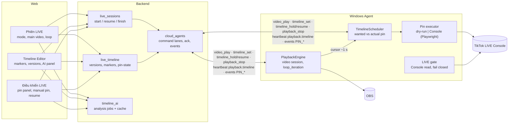
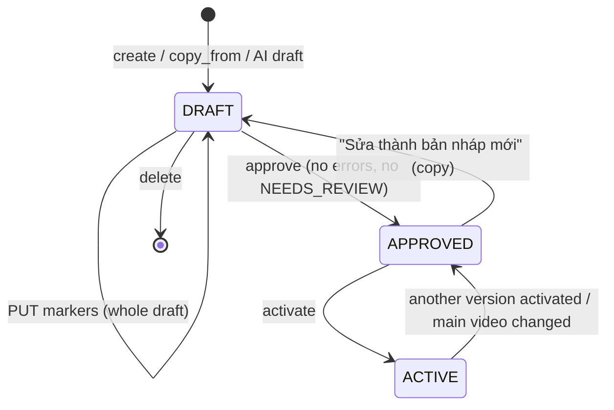
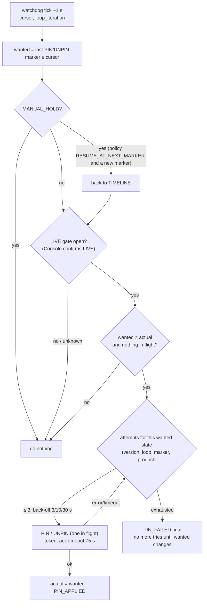
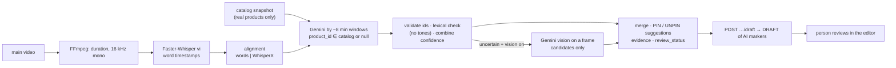

# Single Video Timeline LIVE — playback & pin timeline

Default mode for new LIVE sessions: **one main video plays continuously and products are pinned on TikTok at
timestamps of that video**. The former multi-video / product-queue behaviour stays available as `ADVANCED_LEGACY`.

| | `SINGLE_VIDEO_TIMELINE` | `ADVANCED_LEGACY` |
|---|---|---|
| What plays | one Media Library video (`main_media_id`), looped or once | each product's videos, queue, rotation |
| What pins | the active **timeline version** (markers at ms positions) | manual pins, per-video auto pin |
| Clock | OBS media cursor of the main video (Windows Agent) | video boundaries |
| Product lineup | derived from the active timeline (Console check, AI chat context) | chosen by the operator |
| Default for | new sessions created by the Web | sessions created before this mode, API clients that send no mode |

Code: `backend/app/live_timeline.py`, `backend/app/live_sessions.py`, `backend/app/timeline_ai/`,
`agent-core/src/sarae_agent/timeline/`, `agent-core/src/sarae_agent/playback/engine.py` (`video_play`),
`web/src/TimelineEditor.tsx`, `web/src/TimelinePinPanel.tsx`, `web/src/SingleVideoSetup.tsx`.

---

## 1. Architecture

**Single coordinator:** a session plays on one Agent only (`live_start_claims`); that Agent's scheduler is the only
thing that executes the session's schedule. The Backend never pins on a timer; it only sends the schedule.

---

## 2. Data model (migrations `20261029_0016`, `20261029_0017`)

| Table / column | Purpose |
|---|---|
| `live_sessions.playback_mode` | `SINGLE_VIDEO_TIMELINE` / `ADVANCED_LEGACY` (existing rows: `ADVANCED_LEGACY`) |
| `live_sessions.main_media_id`, `video_loop`, `active_timeline_id` | main video, loop, version in use |
| `live_timelines` | versions per session: `DRAFT → APPROVED → ACTIVE` (one ACTIVE; the previous one returns to APPROVED) |
| `live_timeline_markers` | `at_ms`, `action` (`PIN_PRODUCT` / `UNPIN_PRODUCT` / `NO_ACTION`), `product_id`, `seq`, `source` (`MANUAL`/`AI`), `review_status`, `confidence`, `evidence` (JSON) |
| `timeline_analyses` | AI analysis jobs (status, phase, progress, result, draft made from it) |
| `timeline_ai_cache` | transcript / analysis cache by key |

The wanted/actual pin state is **not** a table: the Agent reports it in every heartbeat (`playback.timeline`), which
the Backend already persists; the pin history is in `live_session_events`.

---

## 3. Timeline lifecycle

Validation (`issues`): a PIN needs a product of the owner's catalog (error); position after the video end (error);
AI marker `NEEDS_REVIEW` (error: blocks approval); timeline made for another main video (error); product without TikTok
id / not ACTIVE / same position as another marker (warnings; at the same position the later marker wins).

Activating while the session is LIVE sends `timeline_set` to the Agent: **playback and OBS are not touched**, the
scheduler recomputes the wanted pin at its current position. If the Agent reports another version than the active one
(heartbeat), the Backend re-sends it (at most once a minute).

---

## 4. Playback

| Command (Agent, lane `live`) | Effect |
|---|---|
| `video_play {session_id, media_id, loop, start_ms, timeline}` | start (or resume at `start_ms`) the main video; a retried start of the running session only updates `loop` |
| `timeline_set {session_id, timeline}` | replace the schedule (keeps actual pin and position) |
| `playback_pause` / `playback_resume` / `playback_seek` | as before |
| `playback_stop` | stops OBS **and clears the scheduler** (any pin on its way becomes stale) |

The engine never switches file at a marker. At the end of the video it restarts the same file when `loop` (and
`loop_iteration` + 1), else the session ends (`PLAYBACK_ENDED`). Start requirements (Backend): main video, TikTok
account, Agent online and idle, Console sync of that account < 10 min old, main video cached on the Agent. Products
missing from the Console cart do **not** block a Single Video start: their pins fail (`PIN_FAILED`) and the video goes on.

---

## 5. Pin scheduler (Windows Agent)

| Situation | Behaviour |
|---|---|
| Polling the same position, pause | nothing (state already matches) |
| Seek forward/back | only the pin in force at the new position (skipped markers are never replayed) |
| Loop | the schedule runs again from 0 (new loop iteration → new attempt budget) |
| Two markers at the same ms | ordered by `seq`, the later wins, one action |
| LIVE not confirmed on the Console | nothing pinned (fail closed); when LIVE: the pin in force now, not the backlog |
| Pin API / Console failure | bounded retries, then `PIN_FAILED` (final) — never an infinite loop |
| Ack lost | after 75 s: failed attempt, actual = unknown, read back from the Console |
| Actual unknown (start, Agent restart, reconnect) | read the pinned card from the Console first; never unpin blindly |
| Pin changed on the Console by a person | detected by the read-back (every 30 s): `MANUAL_OVERRIDE`, timeline holds |
| Manual pin from the Web | `timeline_hold` (same lane, before the pin) with policy `HOLD_UNTIL_RESUME` (default) or `RESUME_AT_NEXT_MARKER`; `POST /sessions/{id}/timeline/resume` ends the hold |
| LIVE stopped | `playback_stop` clears the scheduler; pending Backend commands are cancelled (`cancel_commands`) |
| Product without pin data | `PIN_FAILED` once (final) |

**Dry-run (default).** `config.json` of the Agent: `"timeline": {"dry_run": true, "assume_live_in_dry_run": true}`.
The schedule runs and is reported (`PIN_APPLIED` with `dry_run=True`, pin panel badge) but nothing is clicked on
TikTok. To pin for real on one PC: set `dry_run` to `false` (then the LIVE gate always reads the Console) and restart
the Agent.

**LIVE gate.** `auto_pin.LIVE_STATE_JS` reads visible "end LIVE" / "go LIVE" controls with the labels in
`auto_pin.LIVE_LABELS`. These labels are **not verified on the real Console yet**: check them on the customer's
Console before turning dry-run off; anything unknown keeps the gate closed.

---

## 6. AI Timeline Analyzer (runs on the Backend, before LIVE)

- Every suggestion: `start_ms`, `end_ms`, `product_id`, `action`, `confidence`, `evidence_transcript`,
  `evidence_timestamp_ms`, `match_reason`, `review_status`.
- A product id the LLM invents is dropped (`dropped_products`); a segment without a sure product is `NO_ACTION`
  `NEEDS_REVIEW`. If the speech never names the product, confidence is capped at 0.6. Below `min_confidence` (0.75)
  → `NEEDS_REVIEW`, which blocks approval of the draft.
- Settings `GET/PUT /api/ai/timeline-settings` (owner): Whisper model/device (default from `SARAE_WHISPER_MODEL`,
  `SARAE_WHISPER_DEVICE`, `SARAE_WHISPER_COMPUTE_TYPE`), alignment, LLM provider/model (empty = the owner's AI model),
  vision on/off, thresholds. API keys stay in the AI Assistant settings.
- Cache: transcript by (video revision, transcript+alignment settings); analysis by (video revision, catalog version,
  resolved settings, pipeline version). `force` re-runs everything.
- Install on the server: `pip install -r backend/requirements-timeline-ai.txt` (+ ffmpeg on PATH). It includes the
  CUDA 12 cuBLAS (and cuDNN on Linux) pip packages, installed into the venv only; with an NVIDIA driver, device
  "auto" then runs Whisper on the GPU, otherwise on the CPU.

---

## 7. API summary

| Endpoint | |
|---|---|
| `POST /api/live/sessions` | `playback_mode`, `main_media_id`, `video_loop` (omitted mode = `ADVANCED_LEGACY`) |
| `PATCH /api/live/sessions/{id}` | mode / main video (DRAFT only), loop (any time) |
| `POST /api/live/sessions/{id}/start` · `/resume {position_ms}` · `/finish` | Single sessions use `video_play` |
| `GET/POST /api/live/sessions/{id}/timelines` | list / new draft (`copy_from`) |
| `GET/PATCH/DELETE …/timelines/{tid}` · `PUT …/markers` · `POST …/approve` · `POST …/activate` | |
| `GET /api/live/sessions/{id}/pin-state` | wanted vs actual pin, mode, gate, dry-run (from the heartbeat) |
| `POST /api/live/sessions/{id}/timeline/resume` | end a manual hold |
| `POST /api/live/pin {product_id, timeline_policy}` · `POST /api/live/unpin?timeline_policy=` | manual pin (holds the timeline first) |
| `GET/PUT /api/ai/timeline-settings` · `POST/GET /api/live/sessions/{id}/timeline-analysis[/{job}]` · `POST …/{job}/draft` | AI |

Refused on Single sessions (409): switch product, edit lineup, rotation policy, per-video auto pin.

---

## 8. Deployment & rollback

1. **Backend first** (`alembic upgrade head`; startup also adds the columns/tables), **then** the Windows Agent. An
   older Backend rejects the new Agent event types and the Agent's event outbox would keep retrying.
2. Keep Agents in dry-run; verify the LIVE gate labels and a full rehearsal per Console; then turn dry-run off per PC.
3. Rollback: deploy the previous code **and** `alembic downgrade 20261023_0015` (drops the new columns/tables:
   timelines and AI analyses are lost; sessions and their history stay). Rolling back only the database is not enough:
   the new code's startup schema would add the columns again.
