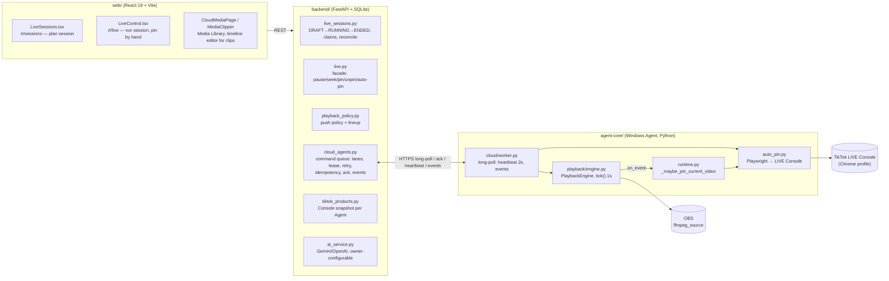
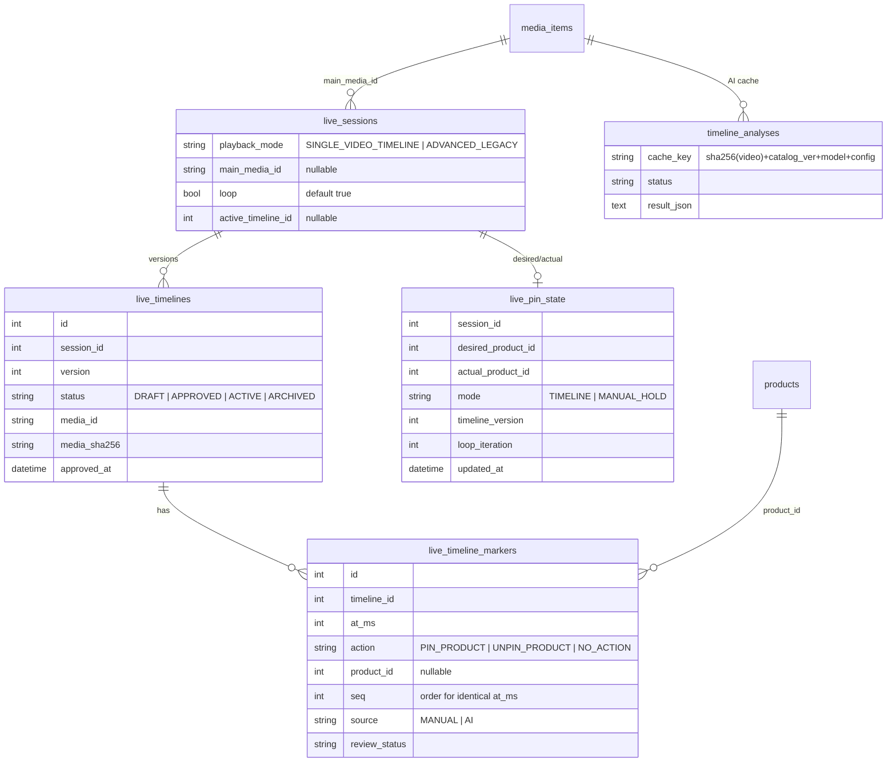
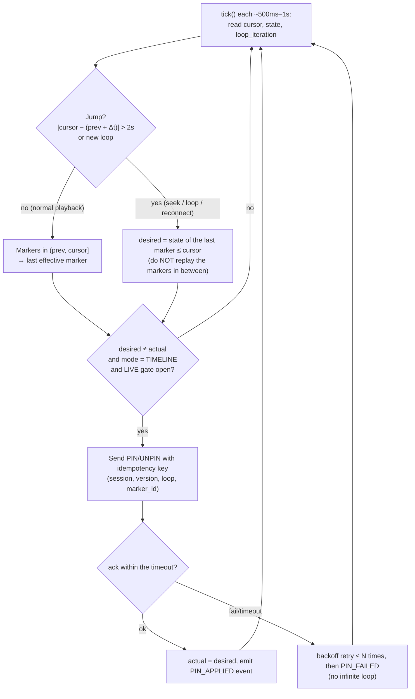
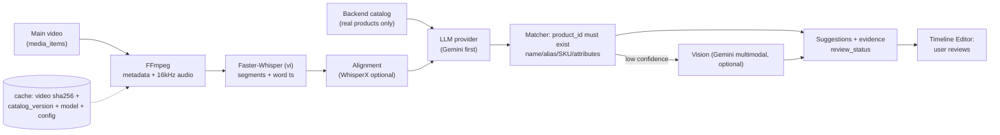

# Single Video Timeline LIVE — Phase 1: Architecture survey and design proposal

Branch: `feature/single-video-timeline-live` (from `dev` @ 41c879b). Date: 2026-10-29.
This document only surveys and proposes. **No code has been changed yet.**

---

## 1. The current architecture

### 1.1 Findings matrix by layer

| Layer | Exists today (reusable) | Missing for Single Video Timeline |
|---|---|---|
| **DB** (`live_sessions`, `live_session_products`, `live_session_events`, `media_items`, `product_media`) | Session lifecycle, event log, `media_items.duration_seconds`, `sha256` | `playback_mode`, main video, timeline/markers/versions, pin state, AI analysis cache |
| **Migrations** | Alembic `20261016_0001` … `20261023_0015` (additive, with `downgrade`). `shop_schema.py` also runs `ALTER TABLE` at startup | New migration `0016` (additive, rollback-able) |
| **Backend session** | start/switch/resume/finish, `acquire_live_claim` (one Agent + one account per session), `reconcile_playback` on every heartbeat | Start a session from one video instead of a product lineup; push the timeline to the Agent |
| **Backend command bus** | `cloud_agents`: lanes `live`/`background`, lease, retry, `Idempotency-Key`, `late_ack`, journal on the Agent | Nothing new needed — **reuse it** for `timeline_set` and the pin commands |
| **Backend pin** | `POST /live/pin`, `/unpin`, `/pin-state`, `/auto-pin` → `PIN_PRODUCT`/`UNPIN_PRODUCT` commands, card matched by `tiktok_product_id`, then name + image + price | A desired vs actual pin-state model; a manual-override policy |
| **Agent playback** | `PlaybackEngine`: seek (`SetMediaInputCursor`), pause/resume, engine-driven loop (OBS `looping:False`), `media_cursor`/`media_duration` from `GetMediaInputStatus`, stall watchdog | A single-video mode; per-loop iteration count; a cursor-based scheduler |
| **Agent pin** | `AutoPinService._pin_on_worker` / `_unpin_on_worker` (3 retries, verification, already-pinned check), "video auto pin" fired on product switch | Scheduling by **position**; dry-run/mock mode; pin outcome sent as an event (today it only goes into the heartbeat) |
| **Agent scheduler** | `scheduler/` (token-guarded, event-driven) — **not wired into the runtime** | — (proposal: don't reuse it; see §3) |
| **"Really LIVE" signal** | `tiktok_observer.py` — **a POC, not imported anywhere** | ⚠ No reliable signal (see question Q1) |
| **Web** | `SeekBar` (LiveControl), `MediaClipper` (timeline + draggable markers + zoom + draft), `<video>` with signed URLs, `apiRequest`/`agentAction` (polls a 202 command), `@sarae/ui` | Video picker, timeline editor for pins, mode selector, pin-state panel |
| **AI** | `ai_service.py`: owner-configurable provider/model, API keys encrypted via `credentials.py`, Gemini REST | The whole Phase 5 pipeline (FFmpeg, Whisper, matching, cache) |
| **Android Agent** | — | **Not touched** (per the spec) |

### 1.2 Notable details from the survey

- `backend/app/playback_engine.py` is a copy of the Agent engine that nothing in the backend imports. It is a legacy file and **will not be touched**.
- A LIVE session is **product-centric**: session → products → each product's video pool. It has no `media_id` field.
- The Agent's loop restarts the file at `OBS_MEDIA_STATE_ENDED`. The cursor is read through one websocket call about once a second, so a pin lands within **about 1 s**.
- Today the outcome of a "video auto pin" reaches the backend only through the heartbeat `pin` field, not as an event, so it cannot be audited.
- `docs/AUTO_PIN_WINDOWS_AGENT.md` is out of date (it still describes only the name-based timer).

---

## 2. Data model proposal (migration `20261029_0016`, additive)

| Change | Backfill for existing rows | Rollback (`downgrade`) |
|---|---|---|
| `live_sessions.playback_mode` | `ADVANCED_LEGACY` (**old sessions keep the old behaviour**) | drop column |
| New session (API) | defaults to `SINGLE_VIDEO_TIMELINE` | — |
| `main_media_id`, `loop`, `active_timeline_id` | NULL / true / NULL | drop column |
| 4 new tables | empty | drop table |

Migrations are split by step: `0016` (step 1, done) = 4 columns on `live_sessions` + `live_timelines` + `live_timeline_markers`; `live_pin_state` comes in step 4 and `timeline_analyses` in step 6, each with its own migration.

**API default (user decision):** a client that omits `playback_mode` gets `ADVANCED_LEGACY` (old clients/tests keep working); the new Web UI always sends `SINGLE_VIDEO_TIMELINE` as the default choice for new sessions.
**Lineup in Single mode (user decision):** a marker must pick a product that exists in the Backend catalog; if the Console has no card for it, the pin reports an error (event) and the timeline keeps running. The session lineup is filled automatically from the products in the active timeline.

No existing table/column/API is dropped or renamed. `shop_schema.py` gets the same `ADD COLUMN IF MISSING` treatment, following the pattern used by `0015`.

---

## 3. Pin scheduler proposal

### 3.1 Who coordinates

| Option | Clock | Latency | Behaviour when the Cloud goes down | Recommendation |
|---|---|---|---|---|
| **A. Scheduler on the Windows Agent** | OBS `media_cursor` | ~1 s | Keeps pinning on schedule | ✅ **Recommended** — matches "the Agent is the authoritative source", and the Agent also holds the Playwright browser |
| B. Scheduler on the Backend, driven by the heartbeat | Cursor from the heartbeat (2 s) | 2–4 s + command round trip | Stops | ✗ |

**Single coordinator:** the Backend records `live_start_claims` (one Agent per session, already in place). The Agent only runs the timeline whose `session_id` matches the session it is playing **and** whose `timeline_version` is the latest. A stale command is rejected, following the token pattern already used in the engine.

### 3.2 Algorithm (position-based, does not replay skipped actions)

| Situation | Behaviour |
|---|---|
| Pause | The cursor stops, so nothing fires. Resume continues from the cursor |
| Seek forward/backward | Compute only the **effective state at the new position**, then make one call if it differs |
| Loop | `loop_iteration++`, so the idempotency key is new and the timeline runs again from 0 |
| Two markers at the same `at_ms` | Ordered by `seq`; the last one wins (the editor shows a warning) |
| Agent reconnects / Cloud loses connection | When the Agent comes back it reads the actual pin state (`GET_PIN_STATE`), then reconciles to desired |
| Pin API (Console) loses connection | Retry with backoff, then `PIN_FAILED`; reconcile once it is back |
| Manual pin during LIVE | `mode = MANUAL_HOLD` (default) until the user clicks "Resume timeline"; option 2 = return to the schedule at the next marker |
| Stopping LIVE | Cancel pending pin commands (`cancel_commands`), clear the Agent queue |
| Product deleted / no longer synced | The marker is flagged `INVALID` and skipped (the Agent never pins a product with no `tiktok_product_id`/card) |
| Timeline edited while running | The DRAFT does not affect the session; when a new version is **activated**, push `timeline_set`, then recompute desired at the current cursor **without** resetting playback/OBS |
| Dry-run | Config `pin_executor = dry_run`: logs + events, **no clicks on TikTok** (the default for all tests) |

---

## 4. Phase 5 — AI Timeline Analyzer (outline)

- Separate module (`backend/app/timeline_ai/`), with replaceable `TranscriptProvider` / `LLMProvider` / `VisionProvider` interfaces, configured from owner settings (reusing `ai_service` + `credentials`), with no hardcoded key/model.
- Every `product_id` the LLM returns is **validated against the catalog**. An invalid or low-confidence one goes to `NEEDS_REVIEW`, and nothing is applied automatically.
- Heavy dependencies (faster-whisper, whisperx/torch) go in an **optional** requirements file and are not added to `requirements.txt` → the backend still runs without them.

---

## 5. Proposed implementation order (each step a separate commit on this branch)

| # | Content | Layer |
|---|---|---|
| 1 | Migration 0016 + models + `playback_mode`/`main_media_id` API, legacy unchanged | BE |
| 2 | Timeline CRUD/versioning API + validation (product valid, `at_ms` ≤ duration) | BE |
| 3 | Engine single-video mode + `loop_iteration` + `timeline_set` command + scheduler + dry-run | Agent |
| 4 | Pin state desired/actual, manual override, reconcile, cancel on stop | BE + Agent |
| 5 | Web: mode selector, video picker, Timeline Editor (reusing the MediaClipper pattern), pin-state panel | Web |
| 6 | AI Timeline Analyzer (mock providers first, real ones after) | BE |
| 7 | Unit + integration tests (FakeObs, dry-run pin), docs for the playback/timeline flow, report | All |

---

## 6. Decisions confirmed by the user (2026-10-29)

| # | Question | Decision | Implementation impact |
|---|---|---|---|
| Q1 | How to tell the session is "really LIVE" | **Read the state from the LIVE Console** (Playwright, on the page the Agent already has open) | Add a read-only `LIVE_STATE_JS` check to `auto_pin.py`. **Fail-closed**: if the LIVE state is unknown or not LIVE, the gate is closed and nothing is pinned. The selector must be checked against the real Console; tests use a fake page |
| Q2 | Where the AI Analyzer runs | **Backend server** | A background worker in the backend; heavy dependencies go in an optional requirements file |
| Q3 | Time format | **HH:MM:SS** | Display and input to the second; stored in `at_ms` |
| Q4 | Pin semantics | **Single pin**: pinning B replaces A | desired/actual hold at most 1 product; `UNPIN_PRODUCT` = remove the current pin |

Proposed defaults (unless the user changes them): manual pin → `MANUAL_HOLD` until "Resume timeline"; activating a new timeline version while running → apply immediately at the current position without resetting playback; in `SINGLE_VIDEO_TIMELINE` mode the old "video auto pin" (pin per product switch) is turned off so the two never conflict.
