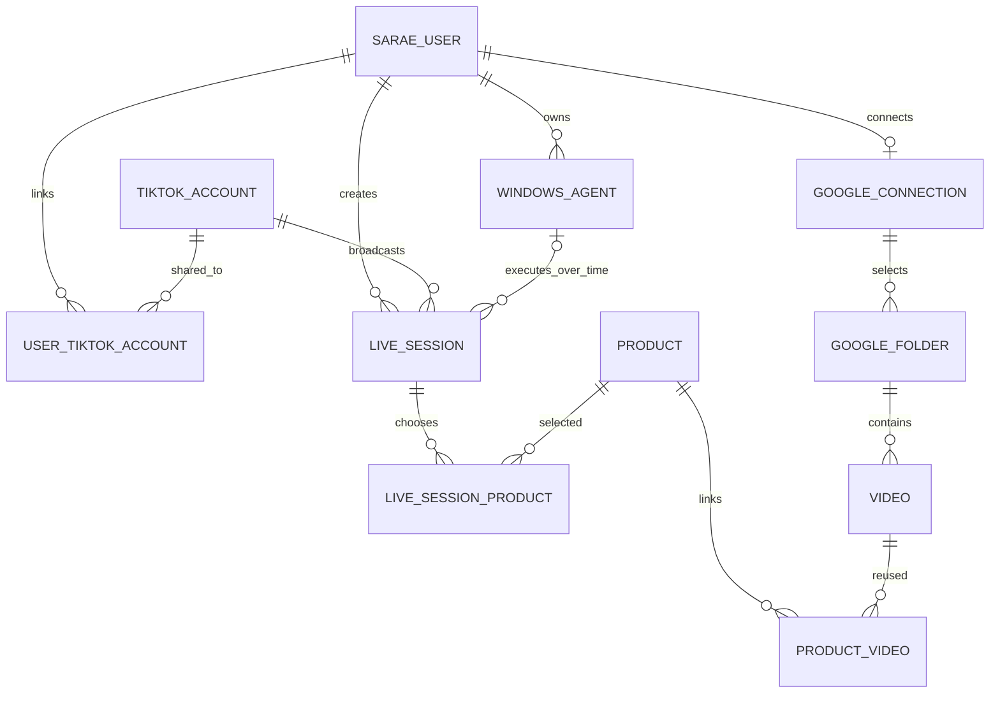
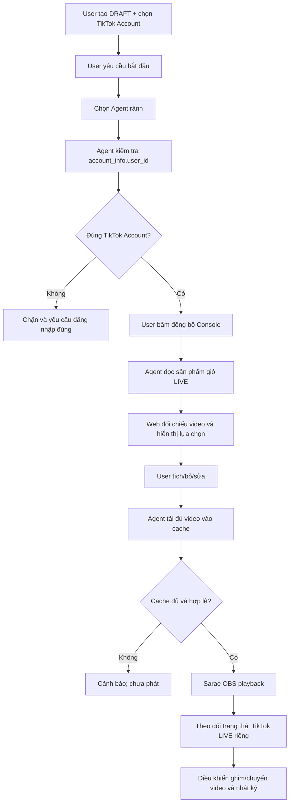

# Tools Sarae — đặc tả nghiệp vụ và lộ trình triển khai
> Phiên bản: 2026-10-21 · Nguồn: các quyết định của chủ dự án trong trao đổi tháng 10/2026.
> Quy ước: **CHỐT** = người dùng xác nhận; **ĐỀ XUẤT** = chưa chốt; **CẦN KIỂM CHỨNG** = phụ thuộc API/thử nghiệm. Tài liệu không đồng nghĩa code đã triển khai.

## 1. Phạm vi và nguyên tắc
- **CHỐT:** Tools Sarae phục vụ TikTok LIVE Seller **và** Affiliate Creator trên một mô hình **TikTok Account** chung. Tài khoản phát LIVE khác với Seller/Shop nguồn của từng sản phẩm.
- **CHỐT:** Sarae Web + Cloud quản lý tài khoản, thư viện video, sản phẩm, phiên LIVE, chính sách điều khiển; Windows Agent là **một ứng dụng trên một máy Windows**, vận hành OBS và TikTok LIVE Console tại máy đó. Agent không phải worker tách task.
- **CHỐT:** Mỗi Sarae User sở hữu nhiều Windows Agent; một Agent chỉ thuộc một User (**User 1:N Agent**). Một máy có đúng một Agent hoạt động; không cho phép chia sẻ Agent giữa các User.
- **CHỐT:** Một TikTok Account có thể được nhiều Sarae User liên kết; một Sarae User có nhiều TikTok Account (**N:N**). Định danh theo `account_info/get.data.user_id`, KHÔNG theo `seller_id`.
- **CHỐT:** Một Agent chỉ có tối đa một phiên LIVE đang thực thi; có thể có nhiều phiên DRAFT chưa gán Agent. Một tài khoản TikTok phát LIVE không được điều khiển đồng thời bởi hai phiên Tools Sarae; khóa theo **TikTok Account user_id**, không theo Seller ID.

## 2. Device identity / kích hoạt
- **CHỐT:** 1 Agent ID ↔ 1 thiết bị vật lý đã kích hoạt lần đầu; không chuyển Agent ID sang máy khác, kể cả đổi máy hoặc bán/chia sẻ.
- **CHỐT:** Gỡ app, cài lại app hoặc cài lại Windows trên **cùng máy** có thể khôi phục Agent ID cũ nếu xác minh được thiết bị. Nếu không xác minh được, mất quyền dùng Agent ID cũ. Khi khôi phục thành công, cấp credential mới, thu hồi credential cũ và bảo toàn lịch sử.
- **CẦN KIỂM CHỨNG:** fingerprint/TPM, trường hợp thay linh kiện/không TPM và quy trình chống giả mạo. Không giả định UUID/MAC/Windows GUID đơn lẻ bảo đảm nhận dạng phần cứng.
- **HIỆN TRẠNG:** credential Windows được lưu DPAPI, chưa chứng minh quy trình recovery sau reinstall Windows.

## 3. TikTok Account và sản phẩm
### Identity từ LIVE Console
- **CHỐT:** `GET /api/v1/streamer_desktop/account_info/get` trong phiên trình duyệt đã đăng nhập: `data.user_id` là định danh LIVE Account chính; `tt_uid` lưu riêng; `user_name`, `nick_name`, avatar là metadata; không dùng username làm khóa.
- **ĐÃ QUAN SÁT:** Seller: `user_type=1`, `user_id=7494647113328657914`, `user_name=sarae.fashion3`. Affiliate: `user_type=3`, `user_id=7495962653689350865`, `user_name=c.b.thi.trang1`. Mapping này dựa trên **hai mẫu response**, chưa giả định mọi loại tài khoản luôn theo đúng mapping.
- **CHỐT:** Khi mở TikTok LIVE Console chỉ mở trang; **không tự đồng bộ**. Khi user chủ động bấm Đồng bộ sản phẩm, Agent **phải kiểm tra account_info** trước, đối chiếu `user_id` với tài khoản/phiên dự kiến; nếu khác → chặn, báo mismatch; không nhập nhầm sản phẩm. API `live_product/list` dùng để lấy sản phẩm trong giỏ LIVE, KHÔNG tạo TikTok Account từ `seller_info.seller_id`.
- **CHỐT:** Giữ `seller_id`/nguồn sản phẩm như metadata định danh Seller nguồn; affiliate có sản phẩm thuộc nhiều Seller trong một phiên. Định danh sản phẩm cần dùng TikTok product ID và Seller ID nếu thật sự cần chống đụng, không dùng tên.
- **CẦN KIỂM CHỨNG:** quan sát request/response account_info ổn định qua trình duyệt TikTok với profile hiện tại, phiên đăng nhập/thay account, trạng thái ghim và LIVE status. Tham số URL ký động như msToken/X-Bogus không hardcode.
- **BẢO MẬT:** Không lưu cookie/token TikTok vào bản ghi sản phẩm hoặc đưa sang Web; giới hạn đường đi dữ liệu profile tối thiểu.

### Relationships (mục tiêu)

Lưu ý: `WINDOWS_AGENT o|--o{ LIVE_SESSION` chỉ thể hiện quan hệ lịch sử; **UNIQUE agent đang chạy** và **UNIQUE account đang LIVE** cần cưỡng chế bằng ràng buộc/lock transaction, không suy từ sơ đồ.

## 4. Google Drive & Media Library
- **CHỐT:** Mỗi Sarae User **một tài khoản Google**, **nhiều thư mục** được chọn làm nguồn video; hỗ trợ upload/download, duyệt, quản lý, xem trước/phát trên Web, liên kết video N:N với sản phẩm.
- **CHỐT:** Đồng bộ thủ công bằng nút và tự động; khi file biến mất khỏi Drive thì xóa khỏi **danh sách Media Library khả dụng**, nhưng phải bảo toàn lịch sử/audit và cache của phiên LIVE đang phát để không gián đoạn.
- **CHỐT:** User **không phải cung cấp API key, mật khẩu hay public link**; hướng kết nối là Google OAuth với consent.
- **CẦN KIỂM CHỨNG TRƯỚC KHI CODE:** Google Drive folder-scoped access cho file hiện có và file thêm sau; `drive.file` không mặc nhiên cho quyền tất cả file con trong folder. Nếu cần scope rộng hơn phải lập kế hoạch verification Google. Thiết kế token storage/refresh/revoke riêng, không công khai bearer token trong URL video.
- **CHỐT:** Agent tải **toàn bộ tập video dùng cho LIVE** về file cache local trước khi phát (random cần toàn bộ tập); kiểm tra checksum/dung lượng, không tải lại file không đổi, không xóa cache khi đang LIVE. Mất Cloud/Internet vẫn tiếp tục theo queue cache nếu OBS/Agent còn hoạt động.
- **CẦN THIẾT KẾ:** quota đĩa, download lỗi, dung lượng thiếu, preview streaming/video range, đồng bộ file nhiều folder và trùng file.

## 5. LIVE Session: tạo nháp, chọn Agent khi bắt đầu
- **CHỐT:** Một User tạo nhiều DRAFT, chọn TikTok Account ngay trong DRAFT, **không chọn Agent lúc tạo**. Có thể đổi TikTok Account/DRAFT; Agent chỉ được phân khi bắt đầu.
- **CHỐT:** Dashboard Web quản lý **nhiều phiên LIVE**, mở trang chi tiết từng phiên; hai máy/phiên độc lập, không ràng buộc vào một Agent chọn toàn cục.
- **CHỐT:** Khi user yêu cầu bắt đầu: chọn Agent rảnh → Agent xác minh TikTok account thực đăng nhập → **đồng bộ thủ công sản phẩm Console bắt buộc** → Web hiển thị các sản phẩm có trong giỏ và sản phẩm nào đã có video → User tích/bỏ chọn và sửa danh sách → tải đủ video → thực thi phát qua OBS.
- **CHỐT:** Sản phẩm không có video được cảnh báo và loại khỏi queue tự động; không tự thêm toàn bộ sản phẩm được quét vào phiên.
- **CHỐT:** Cho phép đồng bộ lại trong LIVE cả chủ động và tự động, khi giỏ sản phẩm thay đổi.
- **CHỐT C4:** Khi User nhấn Bắt đầu trong Sarae, phiên vận hành nội bộ có thể bắt đầu dù TikTok chưa thực sự LIVE. **Phải tách** Sarae playback state và TikTok actual LIVE state, không hiển thị sai thành “TikTok đang LIVE”.
- **CHỐT:** Khi chắc chắn TikTok LIVE thực tế kết thúc thì Sarae tự dừng phiên; nếu không chắc trạng thái không tự động đóng mù quáng.
- **CHƯA CHỐT:** Có trạng thái PREPARING riêng không, thời điểm phát OBS sau khi sync/cache, takeover phiên TikTok đã LIVE từ ngoài Sarae, xử lý thay đổi/không còn sản phẩm trong DRAFT, quy tắc giữ chỗ Agent lúc chuẩn bị.
- **CHƯA CHỐT:** Agent phát nhiều phiên liên tiếp khi phiên cũ vừa kết thúc; bảo đảm không có hai RUNNING cùng Agent.

## 6. Ghim, điều khiển và phát random
- **CHỐT:** TikTok Console là nguồn trạng thái ghim thực tế nếu quan sát được; Agent quan sát và gửi lên Cloud/Web. Nếu user ghim tay, Sarae **chuyển video theo sản phẩm đang ghim**; nếu chưa có video thì cần hành vi an toàn (đề xuất: giữ video đang phát và cảnh báo).
- **CHỐT:** Thao tác ghim thủ công ưu tiên hơn Auto Pin: **tạm dừng Auto Pin** cho đến khi user bật lại. Nếu không đọc được trạng thái ghim, **tiếp tục lịch Auto Pin**, nhưng không được diễn giải “không biết” là “chắc chắn không ghim tay”.
- **CHỐT:** Gỡ nút Auto Pin khỏi Windows Agent UI, giữ chức năng thực thi trong Core; Web bật/tắt và quản lý chính sách Auto Pin.
- **CHỐT:** Random sản phẩm và random video là **hai cấu hình độc lập**, mỗi cấu hình có: tuần tự, random có lặp, random không lặp đến hết rồi xáo mới. Cho chọn chuyển ngay hoặc chờ kết thúc video hiện tại.
- **CHỐT:** User chủ động chuyển sản phẩm thì tạm dừng chế độ auto đến khi User bật lại. Video hỏng thì bỏ qua và chuyển video khác, ghi log.
- **CẦN KIỂM CHỨNG:** event / DOM / Network của TikTok khi ghim tay; auto pin chỉ triển khai ở mức có thể xác nhận, không khẳng định có API realtime chính thức.

## 7. OBS và ranh giới trách nhiệm
- **CHỐT:** Chỉ Windows Agent giữ/cấu hình Host, Port, Password OBS WebSocket, Source và A/B; Web chỉ hiển thị trạng thái và điều khiển LIVE qua Cloud → Agent.
- **CHỐT:** 1 Agent/Windows machine vận hành OBS và LIVE Console trên máy đó. User có thể điều khiển nhiều Agents **của mình** từ các trang LIVE độc lập; Agent A không làm worker phụ cho Agent B.
- **CHỐT:** Cần nút/phương án chuyển sang camera thật để dự phòng khi phát video không khả thi; xác nhận âm thanh, tỷ lệ 9:16, không xoay sai, không nháy, theo dõi LIVE thật trước khi thương mại hóa.
- **HIỆN TRẠNG:** thử nghiệm LIVE và OBS/TikTok còn đang diễn ra; không khẳng định các kiểm tra ngoài TikTok đã pass.

## 8. Trạng thái và khóa đề xuất
- TikTok Account lock: 1 account.user_id tối đa một phiên Tools Sarae ACTIVE; khóa transaction/lease cần tránh race 2 User/2 Agent. Khi Agent offline không được tự giải phóng lock khi TikTok còn có thể LIVE.
- Agent lock: 1 Agent tối đa một phiên thực thi/chuẩn bị tại một thời điểm (**chính sách reserve khi PREPARING còn mở**).
- Tách `sarae_playback_state` (IDLE/PREPARING/RUNNING/STOPPED/ERROR) và `tiktok_live_state` (UNKNOWN/OFFLINE/LIVE/ENDED).
- Audit: giữ các thời điểm account verified, snapshot sản phẩm, chọn sản phẩm, cache verified, ghim phát hiện, ghim do Sarae, chuyển video, dừng LIVE, lỗi.

## 9. Những câu hỏi chưa chốt (KHÔNG tự lập quy tắc)
1. Khi sync/cache đủ: tự chạy video hay User nhấn xác nhận phát?
2. Nếu Account đã LIVE bên ngoài Sarae: tiếp quản, chặn, hay hỏi user?
3. DRAFT chứa sản phẩm bị mất trên Console: giữ nhưng vô hiệu, tự gỡ, hay yêu cầu xác nhận?
4. User ghim tay: Auto Pin dừng tới khi bật lại (**đã chốt E2/F4**), nhưng khi không đọc được sự kiện / thay đổi ghim cần PoC.
5. Agent đang PREPARING: khóa Agent hay cho hủy/chuyển nhiệm vụ?
6. Google OAuth scope đáp ứng folder đã chọn và verification?
7. Phân loại account: đã quan sát user_type 1/3, cần xác nhận các trường hợp khác.
8. TikTok LIVE thực tế: cơ chế phát hiện kết thúc đáng tin cậy?
9. Khôi phục Agent qua reinstall Windows: tiêu chuẩn chứng cứ phần cứng/TPM?
10. Multi-agent LIVE UI: thứ tự ưu tiên Web rollout và việc di chuyển schema `shop_id`/dữ liệu legacy.

## 10. Migration/triển khai an toàn
- Tài liệu là nguồn yêu cầu. Triển khai từng giai đoạn nhỏ có test; không được drop `tiktok_shops`, sản phẩm, video, lịch sử LIVE nếu chưa có mapping và backup.
- **P0:** Profile account_info và chặn mismatch; ngừng sinh Shop từ từng seller_id; bản ghi TikTok Account tách biệt, API trả về danh sách account thực.
- **P1:** Migration + API account-based; chuyển Session khỏi `shop_id` Seller; DRAFT không cần agent, assign khi bắt đầu; Web thống nhất.
- **P2:** Google OAuth folder PoC; Media Library và cache.
- **P3:** LIVE scheduler/pin observer và nhiều phiên, concurrency locks.
- **P4:** device recovery và kiểm thử LIVE thật.
- Không tự diễn giải nghiệp vụ **CHƯA CHỐT** là đã chốt. Không sửa data production; hiện nhánh dev/test.
