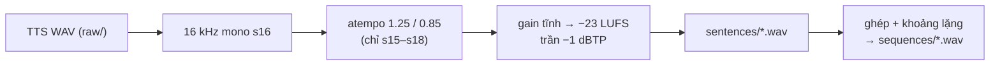

# Phase 0.5 — Bộ audio tiếng Việt kiểm thử

> 2026-11-04. Giọng: profile đã lưu **ST DESIGN 1** (`cfc00c36e9d0481a9fc35055a963fa80`, rev `681594b81f78b59e`) trên Sarae Voice Server (G-OmniVoice), do người dùng chọn. Seed cố định `20261103`. Văn bản: [`phase0/testsets/vi_sentences.json`](../../phase0/testsets/vi_sentences.json). Sinh bằng `phase0/tools/prepare_audio.py` (65 s cho 28 lần gọi TTS).
> File ra (không commit): `outputs/phase0/audio/` — `raw/` (TTS nguyên bản), `sentences/` (24 câu), `sequences/` (6 chuỗi), `manifest.json` (SHA-256, gain, mốc thời gian từng câu).

## 1. Xử lý áp dụng (giống hệt cho mọi engine)

- **Chuẩn hóa độ lớn**: TTS ra từ −21 đến −31 LUFS (s02, s03 nhỏ hơn ~10 dB). Áp một gain tĩnh cho cả câu (−1,9 … +8,4 dB), **không nén động**, để biên độ — tín hiệu mở miệng của model — giữ nguyên hình dạng.
- Không lọc nhiễu, không EQ.

## 2. Các chuỗi kiểm thử

| ID | Mục đích (Phase 0.7) | Độ dài |
|---|---|---|
| `q_short` | 1 câu ngắn | 6,1 s |
| `q_multi` | 5 câu liên tiếp, nghỉ 300 ms | 23,1 s |
| `q_long` | đoạn nói dài | 37,4 s |
| `q_talk_silence_talk` | nói → 4 s im → nói → 2 s im → nói | 19,6 s |
| `q_main` | so sánh chính giữa các engine (nói/im xen kẽ) | 40,3 s |
| `q_endurance_30min` | 312 câu xáo trộn cố định, nghỉ 0,3–3 s | 32 phút 12 s |

## 3. Kiểm tra nội dung bằng ASR (không phải đánh giá chất lượng giọng)

Hai ASR độc lập, offline, model có sẵn trong cache: `faster-whisper-medium` (CPU int8) cho cả 24 câu; `whisper-large-v3-turbo` (CPU) kiểm tra chéo câu đáng ngờ.

| Kết quả | Câu |
|---|---|
| Khớp hoàn toàn / chỉ khác cách ghi số ("159 nghìn" ↔ "một trăm năm mươi chín nghìn") hoặc chính tả từ mượn ("côn tôn", "like") | 22/24 |
| ASR 1 nghe sai, ASR 2 nghe đúng → lỗi ASR | s01 ("chào tạm nhạc" ↔ "chào cả nhà") |
| ASR 1 ảo giác ("Hãy đăng ký kênh…") vì audio quá nhỏ (đỉnh −18 dBFS); ASR 2 nghe "Bó size M nha chị" ≈ đúng | s03 → đã xử lý bằng chuẩn hóa độ lớn |
| Câu "uốn lưỡi" s23 ("Ưu đãi" ↔ "Yêu đã") | cố ý khó, giữ nguyên |

Kết luận: không phát hiện câu TTS đọc sai nội dung. Chất lượng giọng và tự nhiên của TTS **không** thuộc phạm vi Phase 0 (đề bài §10: chưa tích hợp TTS); chỉ cần audio đúng, giống nhau cho mọi engine.
