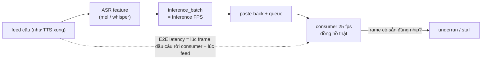

# Phase 0.4 / 0.7 — Benchmark hiệu năng (đo thật trên RTX 3060 12 GB)

> 2026-11-04. Máy: i5-14400F, RTX 3060 12 GB (driver 617.42), 32 GB RAM, Windows 11. **Không LIVE, không OBS, không TTS server** trong lúc đo (VRAM nền 1,1–1,4 GB do desktop/app khác).
> Input chung: clip B chuẩn hóa (`video_b_25fps.mp4`, 1080×1920, 420 frame) trừ khi ghi khác; audio `q_main` (40,25 s, 7 câu, xen kẽ nói/im) — [audio_testset.md](audio_testset.md).
> Số liệu thô: `outputs/phase0/runs/*.metrics.json`, `*.samples.csv` (lấy mẫu 1 Hz), `*.log`.

## 1. Ba cấu hình

| ID | Pipeline | Env | Cách chạy |
|---|---|---|---|
| **LT-W2L256** | LiveTalking `c7269433`, wav2lip_v2 + `wav2lip256.pth` | py3.12, torch 2.9.1+cu128 | adapter [`phase0/engines/lt_offline.py`](../../phase0/engines/lt_offline.py): pipeline realtime nguyên bản, output thay WebRTC bằng consumer 25 fps theo đồng hồ thật |
| **LT-MT15H** | LiveTalking, engine musetalk (UNet 1.5, landmark dlib) — *bản lai*, xem [source_research.md §5](source_research.md) | như trên | như trên |
| **MT15** | MuseTalk `0a89dec4` chính thức, `scripts/realtime_inference.py --version v15` + đường dẫn V15 tường minh, batch 20, fp16 | py3.10, torch 2.0.1+cu118, mmcv 2.0.1, mmpose 1.1.0 | script gốc, không sửa; tài nguyên đo bằng `phase0/tools/monitor.py` |

Thông số engine giữ mặc định upstream (batch 16 LT, 20 MT15). Ngoại lệ có ghi rõ: dò mặt khi tạo avatar Wav2Lip dùng `--face_det_batch_size 2` (xem §3).

## 2. Định nghĩa chỉ số

- **Inference FPS**: `batch / thời gian inference_batch` (có `cuda.synchronize`), median và p05 (batch chậm nhất 5%).
- **Output FPS (wall)**: số frame consumer phát / thời gian thực. Realtime chỉ khi ≈ 25 và **underrun ≈ 0**.
- **Stall**: tổng thời gian consumer đứng chờ (người xem thấy hình đứng).
- **E2E latency**: từ lúc đưa câu vào tới lúc frame đầu tiên của câu được phát.
- **MP4 luôn 25 fps** — không dùng làm căn cứ realtime.

## 3. Chuẩn bị avatar

| | LT-W2L256 | LT-MT15H | MT15 |
|---|---|---|---|
| Clip B (420 frame, 16,8 s) | **155 s** | **628 s** | ~**316 s** 🔶 (= tổng 506 s − sinh frame 104 s − audio 27 s − nạp model ~59 s) |
| Clip A (408 frame) | 154 s ¹ | — | — |
| Clip C (1508 frame, 60 s) | 515 s | — (ước ~38 phút theo tỉ lệ B) 🔶 | — |
| Thành phần chậm | S3FD dò mặt trên GPU | dlib landmark **trên CPU** ở 1080×1920 + face-parse từng frame | DWPose + S3FD + face-parse |

¹ chạy song song với smoke test (GPU chia sẻ) — số tham khảo.

⚠️ **Phát hiện Windows**: tham số mặc định `face_det_batch_size=16` của `wav2lip/genavatar.py` với frame 1080×1920 làm **tràn VRAM sang RAM hệ thống** (WDDM không báo OOM mà chạy chậm hàng chục lần): clip B chạy >58 phút ở VRAM 11,9 GB / GPU 100% mà chưa xong, phải dừng. Batch 2 → 155 s.

## 4. Realtime (pipeline LiveTalking, consumer 25 fps theo đồng hồ thật, `q_main`)

| Chỉ số | LT-W2L256 · B | LT-W2L256 · A | LT-W2L256 · C | LT-MT15H · B (bs16) | LT-MT15H · B (bs8) ² | LT-MT15H · B (bs4) ² |
|---|---|---|---|---|---|---|
| Inference FPS median / p05 | **70,4 / 59,0** | 71,2 / 57,9 | 66,4 / 55,6 | **15,2 / 14,0** | 17,3 / 17,2 | 15,9 / 15,8 |
| Output FPS (wall) | **25,0** | 25,0 | 25,0 | **16,7** | 18,5 | 16,6 |
| Underrun / stall | 2 / 0,02 s | 1 / 0 s | 1 / 0 s | **47 / 18,0 s** | 90 / 12,5 s | 187 / 16,8 s |
| E2E latency median | **1,04 s** | 1,03 s | 1,04 s | **4,90 s** (tăng dần) | 1,90 s | 1,93 s |
| Latency từng câu | 0,94 · 1,04 · 0,98 · 1,10 · 1,02 · 1,04 · 1,09 | | | 1,36 · 2,32 · 3,75 · 4,96 · 4,90 · 8,98 · **10,44** | | |
| VRAM nền → đỉnh (NVML) | 1107 → **3439 MB** | 1119 → 3547 | 1128 → 3544 | 1359 → **11988 MB** | 1329 → 10185 | 1255 → 8960 |
| torch peak allocated | 1224 MB | 1224 | 1224 | 3969 MB | 2944 | 2432 |
| GPU util trung bình | 19% | 21% | 23% | 67% | 64% | 63% |
| CPU tiến trình (100% = 1 lõi) | 142% | 136% | 192% | 294% | 497% | 763% |
| RAM tiến trình đỉnh | 4,3 GB | 4,2 GB | **11,0 GB** ³ | 5,1 GB | 4,9 GB | 4,8 GB |
| Nạp model + avatar | 13,5 s | 6,2 s | 26,3 s | 19,9 s | 17,1 s | 16,3 s |

² tinh chỉnh ngoài mặc định để kiểm tra giả thuyết "chậm do tràn VRAM": batch nhỏ giảm VRAM nhưng FPS không lên → **giới hạn là sức tính GPU**, không phải VRAM.
³ LiveTalking giữ mọi frame 1080×1920 của avatar trong RAM (1508 frame ≈ 9,4 GB) — clip càng dài càng tốn RAM.

## 5. MuseTalk 1.5 chính thức (script gốc, xử lý theo lô, `q_main` = 1006 frame)

| Chỉ số | Có lưu ảnh PNG (tạo MP4) | `--skip_save_images` (đo tốc độ như README) |
|---|---|---|
| Đặc trưng audio (whisper) | 27,2 s (lần đầu, có khởi tạo) | 3,2 s |
| Sinh 1006 frame | 104,0 s → **9,7 FPS** | 71,4 s → **14,1 FPS** |
| RTF (thời gian xử lý / 40,25 s audio) | 2,58 | **1,77** (chậm hơn realtime) |
| VRAM nền → đỉnh | 1251 → 8571 MB | 1334 → **8639 MB** |
| GPU util trung bình | 40% (cả chuẩn bị) | 57% |
| Tổng thời gian lệnh | 506 s (gồm chuẩn bị avatar) | 133 s (gồm nạp model ~59 s) |

MuseTalk chính thức không có chế độ stream: nhận cả file audio, sinh toàn bộ frame (kể cả đoạn im lặng), rồi ghép MP4. Không đo được E2E latency theo nghĩa livestream; latency tối thiểu ≈ thời gian xử lý cả câu.

## 6. Kết luận hiệu năng (chỉ dựa trên số đo)

| Tiêu chí | LT-W2L256 | LT-MT15H | MT15 |
|---|---|---|---|
| Inference ≥ 25 FPS | ✅ ~70 (2,8× dư) | ❌ 15–17 | ❌ 14,1 |
| Phát realtime 25 FPS không đứng hình | ✅ | ❌ (stall 18 s / 40 s) | ❌ (không có chế độ stream; RTF 1,77) |
| Latency ổn định | ✅ ~1,0 s | ❌ tăng không giới hạn (1,4 → 10,4 s trong 40 s) | — |
| VRAM đỉnh (cộng thêm nền) | ~2,3 GB | ~8,7–10,6 GB ⚠️ sát 12 GB | ~7,3 GB |
| Chừa VRAM cho OBS + TTS (≈ 3–4,5 GB) | ✅ | ❌ | ⚠️ |

Số công bố của LiveTalking (README: wav2lip256 60 FPS trên 3060; musetalk 42 FPS trên 3080Ti, khuyến nghị ≥ 3080Ti) **khớp** với đo thực tế: wav2lip256 ~70 FPS; musetalk ~15 FPS trên 3060.

## 7. Endurance 30 phút

Xem [final_report.md §7](final_report.md).
