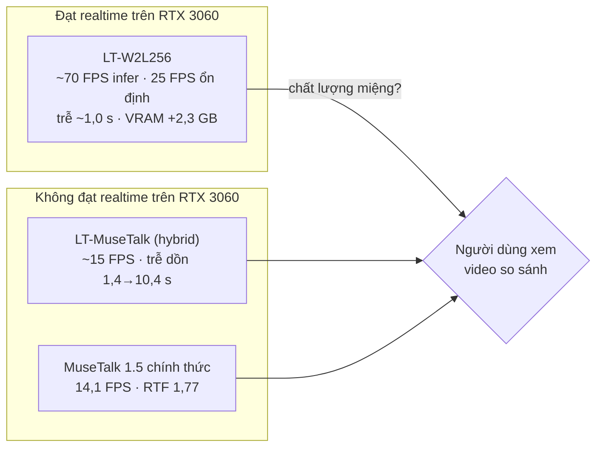

# Phase 0 — Báo cáo tổng hợp: Digital Human Feasibility

> **Trạng thái: `PENDING_USER_REVIEW`** (2026-11-04)
> Lý do chưa PASS: điều kiện §14.7 — người dùng chưa xem và xác nhận chất lượng nhân vật. Các điều kiện kỹ thuật §14.1–14.6 đã đạt với **LT-W2L256** (chi tiết §8).
> Tài liệu liên quan: [source_research.md](source_research.md) · [input_validation.md](input_validation.md) · [models.md](models.md) · [audio_testset.md](audio_testset.md) · [benchmark.md](benchmark.md) · [quality_review.md](quality_review.md) · [plan.md](plan.md)

## 1. Tóm tắt một trang

1. **Chỉ một engine chạy được realtime trên máy này: LiveTalking + Wav2Lip256** (inference ~70 FPS, phát 25 FPS ổn định, trễ ~1 s, VRAM thêm ~2,3 GB — đủ chỗ cho OBS và TTS).
2. **MuseTalk 1.5 (cả bản tích hợp LiveTalking lẫn bản chính thức) chỉ đạt 14–17 FPS** trên RTX 3060 → không livestream realtime được. Đúng với khuyến nghị "RTX 3080Ti trở lên" của LiveTalking.
3. Quan sát sơ bộ trên ảnh tĩnh: **vùng miệng MuseTalk nét và tự nhiên hơn**, Wav2Lip256 mềm/nhòe hơn. → Đánh đổi chất lượng ↔ hiệu năng; **người dùng quyết định** bằng video so sánh.
4. Không engine nào tạo chuyển động mới: cơ thể = video gốc lặp ping-pong. Đó là giới hạn chung, cần tự phát triển ở phase sau.

## 2. Bảng so sánh (đề bài §13)

Ký hiệu: **[đo]** số đo thực trên RTX 3060 · **[quan sát]** nhận xét sơ bộ của Claude trên ảnh tĩnh, chờ người dùng xác nhận · **[chờ]** cần người dùng.

| Tiêu chí | LiveTalking Wav2Lip256 | LiveTalking MuseTalk (hybrid 1.5) | MuseTalk 1.5 chính thức |
|---|---|---|---|
| Avatar preparation (clip B 16,8 s) | [đo] **155 s** | [đo] 628 s | [đo] ~316 s (suy ra từ tổng) |
| Lip-sync quality | [quan sát] khớp nhịp, miệng mềm/nhòe · [chờ] | [quan sát] khớp, môi rõ · [chờ] | [quan sát] khớp, môi rõ · [chờ] |
| Face identity | [quan sát] giữ nguyên · [chờ] | [quan sát] giữ nguyên · [chờ] | [quan sát] giữ nguyên · [chờ] |
| Facial artifacts | [quan sát] lòng miệng tối, môi dưới đôi khi mờ | [quan sát] im lặng vẫn hé môi/lộ răng (khi model chạy trên đoạn im) | [quan sát] ít |
| Natural motion | video gốc ping-pong (không sinh chuyển động) | như trái | như trái |
| FPS inference | [đo] **70,4** (p05 59,0) | [đo] 15,2 (bs16) · 17,3 (bs8) | [đo] 14,1 (gồm blend) |
| FPS end-to-end (phát theo đồng hồ thật) | [đo] **25,0**, stall 0,02 s/40 s | [đo] 16,7, stall 18 s/40 s | không có chế độ stream; RTF 1,77 |
| VRAM peak (NVML, gồm nền ~1,1–1,4 GB) | [đo] **3,4–3,6 GB** | [đo] 12,0 GB (bs16) · 10,2 GB (bs8) | [đo] 8,6 GB |
| Latency (đưa câu → frame đầu câu) | [đo] **~1,04 s**, ổn định | [đo] tăng dần 1,4 → 10,4 s | ≥ thời gian xử lý cả câu |
| 30-minute endurance | [đo] ✅ 32 phút, 24,96 FPS, stall 3 s, trễ 0,97 s (trôi +0,2 s/giờ), không rò bộ nhớ | không chạy (không đạt realtime) | không chạy |
| Real-time readiness | ✅ | ❌ | ❌ |
| License / ràng buộc | code Apache-2.0; **weights wav2lip256 không rõ nguồn/license**; **watermark "LiveTalking" bắt buộc** | code Apache-2.0; weights MuseTalk MIT; face-parse train trên dữ liệu phi thương mại 🔶; watermark | code MIT; như cột giữa trừ watermark |

## 3. Trả lời các câu hỏi tương thích (đề bài §4.C)

| # | Câu hỏi | Trả lời |
|---|---|---|
| 1 | LiveTalking tích hợp MuseTalk phiên bản nào? | Model **1.5** (`musetalkV15/unet.pth`), mặc định `version='v15'` |
| 2 | Có hỗ trợ 1.5 thực sự? | **Bản lai**: đúng UNet/VAE/Whisper/extra_margin/mask `jaw`; khác ở landmark (dlib thay DWPose) và cửa sổ audio streaming |
| 3 | Cần sửa gì để thành 1.5 trung thực? | Khôi phục DWPose, ép `bbox_shift=0` cho v15, bỏ watermark, (tùy chọn) zero-pad audio như bản gốc |
| 4 | Tái dùng avatar cache? | Được về định dạng file (giống hệt); khác ở bbox/watermark |
| 5 | Cần MuseTalk độc lập để so công bằng? | Có — đã chạy (cột 3). Kết quả hiệu năng hai bản MuseTalk tương đương (14–17 FPS) |

## 4. Đầu vào đã dùng

| | Nguồn | Trạng thái |
|---|---|---|
| Video | 3 clip iPhone người dùng quay (A đứng yên, B ngồi nửa người có cử chỉ, C 60 s nhiều chuyển động) — chuẩn hóa 25 fps, cắt đoạn bật/tắt máy | [input_validation.md](input_validation.md) |
| Audio | 24 câu tiếng Việt, giọng ST DESIGN 1 (voice-server), chuẩn hóa −23 LUFS; 6 chuỗi kiểm thử | [audio_testset.md](audio_testset.md) |
| Model | MuseTalk 1.5 + phụ trợ từ HuggingFace (hash khớp), wav2lip256 do người dùng tải | [models.md](models.md) |

## 5. Câu hỏi then chốt: một video 60 s có dùng cho live nhiều giờ được không?

| Khả năng | Có? | Cách |
|---|---|---|
| Nói câu mới tiếng Việt chưa từng nói | ✅ | lip-sync từ audio TTS (đã kiểm chứng 24 câu) |
| Khẩu hình đồng bộ | ✅ (mức chất lượng chờ người dùng) | |
| Chạy liên tục không tạo lại video | ✅ với LT-W2L256 | avatar cache 1 lần, phát vòng lặp |
| Chuyển động tự nhiên nhiều giờ | ⚠️ một phần | chỉ lặp ping-pong video gốc → động tác tay chạy ngược ở nửa chu kỳ; cần tự xây đồ thị clip + điểm nối (phase sau) |
| Biểu cảm thay đổi theo nội dung | ❌ | model chỉ sửa nửa dưới mặt |

## 6. Rủi ro và phương án

| Rủi ro | Mức | Phương án |
|---|---|---|
| Chất lượng miệng Wav2Lip256 chưa đủ "như thật" | chờ người dùng | (a) quay lại video nửa người, mặt to, sáng hơn (crop 256 ít bị phóng); (b) thử engine khác nhẹ hơn MuseTalk; (c) GPU mạnh hơn cho MuseTalk |
| MuseTalk không đạt realtime trên 3060 | cao | TensorRT/ONNX fp16 cho UNet+VAE, giảm độ phân giải paste-back, hoặc GPU ≥ 3080Ti/4070 Ti; hoặc **pre-render** các câu cố định (giới thiệu sản phẩm) bằng MuseTalk và dùng Wav2Lip cho câu trả lời realtime |
| Watermark LiveTalking + weights wav2lip256 không rõ license | cao (thương mại) | dùng LiveTalking làm tham chiếu; sản phẩm tự viết runtime (kiến trúc 3 luồng đơn giản) và tìm/train checkpoint có license rõ |
| Tạo avatar mặc định tràn VRAM trên Windows | trung bình | luôn `face_det_batch_size` nhỏ; thêm kiểm tra VRAM |
| RAM tỉ lệ với độ dài clip (C: 11 GB) | trung bình | clip nguồn ngắn/nén frame trong RAM |
| Chia GPU với OBS + TTS khi live | trung bình | LT-W2L256 chỉ dùng ~2,3 GB và ~20% GPU — còn dư; cần test khi OBS chạy thật |

## 7. Endurance 30 phút (LT-W2L256, clip B, phát theo đồng hồ thật)

Chuỗi `q_endurance_30min`: 312 câu (24 câu xáo trộn cố định), nghỉ 0,3–3 s, đưa vào từng câu đúng thời điểm như TTS. Kết quả run2 (run1 cho cùng FPS/RAM/VRAM nhưng số latency sai do lỗi adapter, đã sửa — giữ run1 làm số đối chứng). File: `outputs/phase0/runs/lt_w2l256_b_endurance30.*`.

| Chỉ số | Kết quả | Đánh giá |
|---|---|---|
| Thời gian chạy | 1933,9 s (32,2 phút), 48 304 frame | ✅ |
| Output FPS (wall) | **24,96** | ✅ |
| Underrun / tổng stall | 82 lần / **2,98 s** (≈ 36 ms mỗi lần = hụt 1 frame); phân bố đều 6–18 lần / 5 phút | ✅ nhỏ, không dồn |
| Inference FPS median / p05 | 84,5 / 52,9 | ✅ luôn > 25 |
| E2E latency p50 / p95 / max | **0,97 / 1,09 / 1,16 s** | ✅ |
| Latency theo thời gian (median mỗi 5 phút) | 0,93 → 0,94 → 0,94 → 0,96 → 1,00 → 1,02 → 1,01 s | ⚠️ **trôi +0,2 s/giờ** — chưa ảnh hưởng 30 phút, cần test 3–4 giờ |
| RAM tiến trình | 4240 → 4234 MB (slope −0,18 MB/phút) | ✅ không rò rỉ |
| torch peak allocated | 1224 MB, không đổi | ✅ |
| VRAM NVML (toàn hệ thống) | 3509 → 3586 MB, đỉnh 3939 MB (run1: phẳng 3510 → 3512) | ✅ không OOM; tăng nhẹ ở run2 không đến từ torch (allocated không đổi) — có thể từ app khác trên máy 🔶 |
| GPU util / CPU tiến trình | 23,5% / 193% (≈ 2 lõi) | ✅ dư tài nguyên |
| A/V trong file | video 1932,16 s = audio 1932,16 s | ✅ (audio gắn cứng 2×20 ms/frame trong pipeline) |
| Treo / exception | 0 | ✅ |
| Nháy hình khi chuyển nói/im | không thấy nhảy vị trí trên ảnh tĩnh; độ nét môi đổi nhẹ | [chờ] người dùng xem video |

Giới hạn của phép thử: chạy **không có OBS và TTS cùng lúc** (máy dành riêng cho benchmark); đo trễ từ lúc câu audio sẵn sàng (chưa cộng thời gian TTS sinh câu).

## 8. Điều kiện hoàn thành (đề bài §14)

| # | Điều kiện | Trạng thái |
|---|---|---|
| 1 | ≥1 engine chạy với video người dùng | ✅ cả 3 engine trên clip B; W2L trên A, B, C |
| 2 | Khẩu hình từ audio tiếng Việt mới | ✅ |
| 3 | Có MP4 để đánh giá | ✅ `outputs/phase0/` |
| 4 | Hiệu năng đo thật trên RTX 3060 | ✅ [benchmark.md](benchmark.md) |
| 5 | Kết quả endurance | ✅ §7 (LT-W2L256) |
| 6 | Không lỗi nghiêm trọng làm engine dừng | ✅ (LT-W2L256) |
| 7 | Người dùng xác nhận chất lượng | ⏳ **chờ** — [quality_review.md §4](quality_review.md) |
