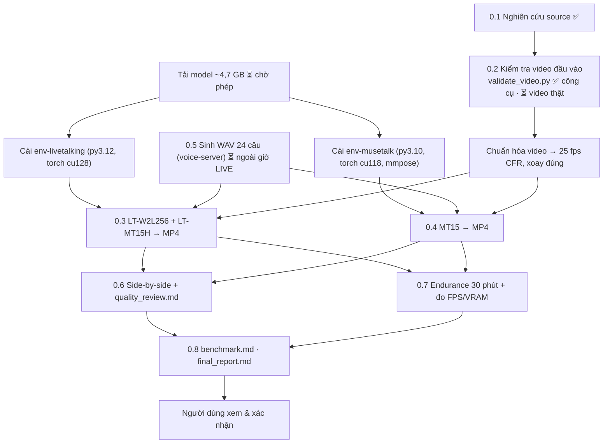

# Phase 0 — Kế hoạch triển khai & trạng thái

> Trạng thái tổng: **`PENDING_USER_REVIEW`** (2026-11-04 18:00). Mọi bước kỹ thuật 0.1–0.8 đã chạy; chờ người dùng xem video và điền [quality_review.md §4](quality_review.md). Kết luận: [final_report.md](final_report.md).
> Nghiên cứu source: [source_research.md](source_research.md).

## 1. Ba cấu hình sẽ benchmark

| ID | Pipeline | Vì sao |
|---|---|---|
| `LT-W2L256` | LiveTalking OSS, engine wav2lip (wav2lip_v2, 256 px) | baseline đề bài |
| `LT-MT15H` | LiveTalking OSS, engine musetalk (UNet 1.5, landmark dlib) | pipeline tích hợp — là **bản lai**, không gọi là "MuseTalk 1.5" |
| `MT15` | MuseTalk 1.5 chính thức, `scripts/realtime_inference.py --version v15` + đường dẫn V15 tường minh | benchmark công bằng |

Cùng video (đã chuẩn hóa 25 fps CFR), cùng WAV 16 kHz mono, cùng crop policy mặc định của từng engine (ghi rõ nếu chỉnh). Không postprocess; nếu có thì lưu cả bản raw.

## 2. Luồng thực hiện



## 3. Cách đo (để không lẫn các loại FPS)

| Chỉ số | Định nghĩa | Lấy từ đâu |
|---|---|---|
| Inference FPS | frame/giây chỉ tính lời gọi model (UNet/Wav2Lip + VAE decode) | log `inferfps` của LT; timer quanh `inference_batch` / vòng UNet của MT15 |
| Processing FPS | frame/giây của toàn pipeline gồm feature audio, blend, encode | LT `finalfps`; MT15 tổng thời gian / số frame |
| Output FPS | fps khai báo của MP4 | ffprobe (luôn 25 — **không** dùng làm căn cứ realtime) |
| RTF | thời gian xử lý / thời lượng audio; realtime khi RTF ≤ 1 *liên tục* | đo wall-clock |
| E2E latency | từ lúc đẩy WAV vào tới khi frame có miệng cử động đầu tiên ra output | đóng dấu thời gian + tín hiệu "beep" đầu câu |
| A/V drift | lệch PTS audio/video ở cuối phiên 30 phút | ffprobe trên bản ghi |
| VRAM/GPU/CPU/RAM | lấy mẫu 1 Hz, ghi VRAM nền trước khi chạy | NVML + psutil (`phase0` env) |

## 4. Cần từ người dùng (ngày mai)

| # | Việc | Vì sao chặn |
|---|---|---|
| ~~U1~~ | ✅ 2026-11-04: nhận 3 clip `.MOV`, đã chuẩn hóa | |
| ~~U2~~ | ✅ 2026-11-04: người dùng cho phép; đã tải 4,2 GB, hash khớp | |
| ~~U3~~ | ✅ 2026-11-04: người dùng đã tải `wav2lip256.pth` | |
| ~~U4~~ | ✅ 2026-11-04: người dùng chọn giọng đã lưu **ST DESIGN 1** (`cfc00c36…`) trên voice-server | |
| U5 | Khung giờ **không LIVE** để chạy GPU (benchmark + endurance 30 phút × 3 cấu hình ≈ 2–3 giờ) | VRAM/GPU đang chia với OBS |
| U6 | Quyết định về watermark LiveTalking (giữ để benchmark, hay bỏ trong fork chỉ dùng nội bộ) | README LT §8 |

## 5. Lệnh sẽ chạy (khi có dữ liệu)

```powershell
cd phase0
uv run python tools/validate_video.py ..\inputs\phase0\video_a.mp4 --kind static --out ..\outputs\phase0\validation
uv run python tools/prepare_audio.py --voice-id <voice_id>          # ngoài giờ LIVE
```

Các bước cài engine và chạy benchmark sẽ được thêm vào đây khi thực hiện (kèm commit, phiên bản, lỗi gặp phải).

## 6. Nhật ký

| Thời điểm | Việc | Kết quả |
|---|---|---|
| 2026-11-03 23:39 | Khảo sát máy | RTX 3060 12 GB, driver 617.42 (CUDA 13.4), không nvcc, Python 3.12.16, uv 0.13.6, FFmpeg 9.0.2, F: trống 459 GB. OBS đang LIVE, VRAM nền 4,4 GB |
| 2026-11-03 23:40 | Clone shallow 2 repo | LT `c7269433`, MT `0a89dec4` |
| 2026-11-03 23:42 | Smoke test `validate_video.py` trên clip dựng từ ảnh demo MuseTalk (`yongen.jpeg`, zoom/pan 6 s) | Công cụ chạy đúng (WARN do 720p/6 s/bitrate thấp — đúng kỳ vọng). **Không phải căn cứ PASS** |
| 2026-11-03 | Không chạy GPU, không tải model, không gọi TTS server | Do máy đang LIVE |
| 2026-11-04 14:00 | Kiểm tra máy: không có OBS, GPU 9% / 3,2 GB | Bắt đầu tải model |
| 2026-11-04 14:00–14:11 | Tải model chọn lọc từ huggingface.co | Lần 1 lỗi CDN Xet (`getaddrinfo failed`) cho `unet.pth`, `sd-vae`; tải lại `HF_HUB_DISABLE_XET=1` + pin revision → OK. 4,2 GB, SHA-256 khớp ([models.md](models.md)) |
| 2026-11-04 14:12–14:25 | Kiểm tra 3 clip người dùng | Phát hiện lỗi tracker (nhận tay là mặt) → sửa; cắt đoạn bật/tắt máy; chuẩn hóa 25 fps. A WARN, B WARN, C FAIL (quay đầu gần profile — giữ làm stress test) ([input_validation.md](input_validation.md)) |
| 2026-11-04 14:31 | Người dùng tự tải `wav2lip256.pth` | 214,7 MB, torch zip hợp lệ, không có hash công bố để đối chiếu |
| 2026-11-04 ~14:40 | Bật voice-server (`run.ps1`), sinh 24 câu + 6 chuỗi bằng giọng ST DESIGN 1 | 65 s; ASR kiểm tra: không câu nào đọc sai nội dung; TTS chênh độ lớn 10 dB → thêm gain tĩnh về −23 LUFS ([audio_testset.md](audio_testset.md)). Tắt voice-server sau khi xong (VRAM về 873 MB) |
| 2026-11-04 15:00 | Cài env `livetalking` (py3.12, torch 2.9.1+cu128, dlib-bin + face_recognition --no-deps) và `musetalk` (py3.10, torch 2.0.1+cu118, mmcv 2.0.1 wheel OpenMMLab, mmpose 1.1.0; chumpy cần `--no-build-isolation`; bỏ tensorflow/gradio/tensorboard vì chỉ `app.py`/`train.py` dùng) | Cả hai nhận CUDA RTX 3060. Env ở `F:\Coder\phase0_vendor\envs\` |
| 2026-11-04 15:00–15:58 | Tạo avatar Wav2Lip clip B mặc định | **Tràn VRAM** (S3FD batch 16 × 1080×1920), >58 phút chưa xong → dừng. Batch 2: 155 s |
| 2026-11-04 16:00–16:50 | Benchmark realtime 3 cấu hình trên clip B (+ W2L trên A, C) | [benchmark.md](benchmark.md). Chỉ LT-W2L256 đạt realtime |
| 2026-11-04 16:50 | Video so sánh + quan sát chất lượng | [quality_review.md](quality_review.md) |
| 2026-11-04 16:48–17:21 | Endurance 32 phút LT-W2L256 (run1) | FPS/RAM/VRAM hợp lệ; latency sai do adapter khớp tên câu lặp lại → sửa (khóa theo lượt feed), chạy lại (run2) |
| 2026-11-04 17:25–17:58 | Endurance run2 LT-W2L256 | ✅ 32 phút, 24,96 FPS, stall 3 s, trễ p50 0,97 s (trôi +0,2 s/giờ), RAM phẳng ([final_report.md §7](final_report.md)) |
