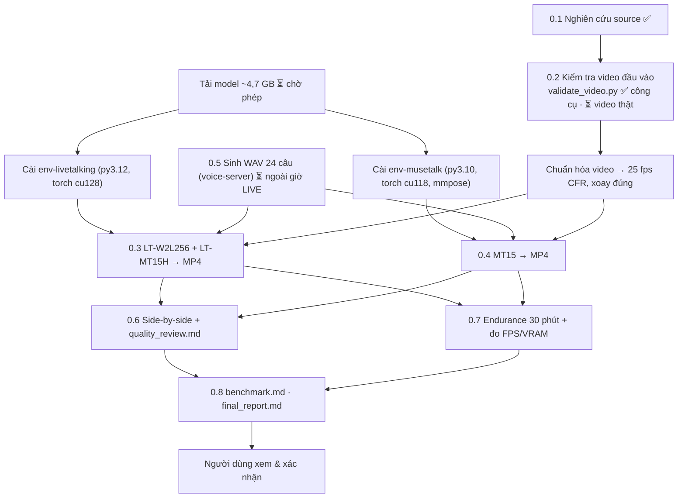

# Phase 0 — Kế hoạch triển khai & trạng thái

> Trạng thái tổng: **`PENDING_USER_INPUT`** (2026-11-03). Phase 0.1 xong; 0.2 có công cụ, chờ video thật; 0.3–0.7 chưa chạy (cần tải model + GPU rảnh).
> Nghiên cứu source: [source_research.md](source_research.md).

## 1. Ba cấu hình sẽ benchmark

| ID | Pipeline | Vì sao |
|---|---|---|
| `LT-W2L256` | LiveTalking OSS, engine wav2lip (wav2lip_v2, 256 px) | baseline đề bài |
| `LT-MT15H` | LiveTalking OSS, engine musetalk (UNet 1.5, landmark dlib) | pipeline tích hợp — là **bản lai**, không gọi là "MuseTalk 1.5" |
| `MT15` | MuseTalk 1.5 chính thức, `scripts/realtime_inference.py --version v15` + đường dẫn V15 tường minh | benchmark công bằng |

Cùng video (đã chuẩn hóa 25 fps CFR), cùng WAV 16 kHz mono, cùng crop policy mặc định của từng engine (ghi rõ nếu chỉnh). Không postprocess; nếu có thì lưu cả bản raw.

## 2. Luồng thực hiện



## 3. Cách đo (để không lẫn các loại FPS)

| Chỉ số | Định nghĩa | Lấy từ đâu |
|---|---|---|
| Inference FPS | frame/giây chỉ tính lời gọi model (UNet/Wav2Lip + VAE decode) | log `inferfps` của LT; timer quanh `inference_batch` / vòng UNet của MT15 |
| Processing FPS | frame/giây của toàn pipeline gồm feature audio, blend, encode | LT `finalfps`; MT15 tổng thời gian / số frame |
| Output FPS | fps khai báo của MP4 | ffprobe (luôn 25 — **không** dùng làm căn cứ realtime) |
| RTF | thời gian xử lý / thời lượng audio; realtime khi RTF ≤ 1 *liên tục* | đo wall-clock |
| E2E latency | từ lúc đẩy WAV vào tới khi frame có miệng cử động đầu tiên ra output | đóng dấu thời gian + tín hiệu "beep" đầu câu |
| A/V drift | lệch PTS audio/video ở cuối phiên 30 phút | ffprobe trên bản ghi |
| VRAM/GPU/CPU/RAM | lấy mẫu 1 Hz, ghi VRAM nền trước khi chạy | NVML + psutil (`phase0` env) |

## 4. Cần từ người dùng (ngày mai)

| # | Việc | Vì sao chặn |
|---|---|---|
| U1 | Video A (static), B (natural motion), C (~60 s) — MP4 từ điện thoại, 1080×1920, đủ sáng, mặt không bị che | Không có video thật thì Phase 0 không thể PASS |
| U2 | Cho phép tải model ~4,7 GB (HF `TMElyralab/MuseTalk` chỉ `musetalkV15/*`, `sd-vae-ft-mse`, `whisper-tiny`, `DWPose`, face-parse, s3fd) | §15 đề bài: không tự tải model lớn |
| U3 | Tải `wav2lip256.pth` từ Google Drive/Quark của LiveTalking (bạn tải giúp, hoặc cho phép tôi dùng gdown) | file không có trên HF, không có checksum |
| U4 | Chọn giọng: `voice_id` trên voice-server để sinh 24 câu, hoặc đưa WAV có sẵn | cùng audio cho mọi engine |
| U5 | Khung giờ **không LIVE** để chạy GPU (benchmark + endurance 30 phút × 3 cấu hình ≈ 2–3 giờ) | VRAM/GPU đang chia với OBS |
| U6 | Quyết định về watermark LiveTalking (giữ để benchmark, hay bỏ trong fork chỉ dùng nội bộ) | README LT §8 |

## 5. Lệnh sẽ chạy (khi có dữ liệu)

```powershell
cd phase0
uv run python tools/validate_video.py ..\inputs\phase0\video_a.mp4 --kind static --out ..\outputs\phase0\validation
uv run python tools/prepare_audio.py --voice-id <voice_id>          # ngoài giờ LIVE
```

Các bước cài engine và chạy benchmark sẽ được thêm vào đây khi thực hiện (kèm commit, phiên bản, lỗi gặp phải).

## 6. Nhật ký

| Thời điểm | Việc | Kết quả |
|---|---|---|
| 2026-11-03 23:39 | Khảo sát máy | RTX 3060 12 GB, driver 617.42 (CUDA 13.4), không nvcc, Python 3.12.16, uv 0.13.6, FFmpeg 9.0.2, F: trống 459 GB. OBS đang LIVE, VRAM nền 4,4 GB |
| 2026-11-03 23:40 | Clone shallow 2 repo | LT `c7269433`, MT `0a89dec4` |
| 2026-11-03 23:42 | Smoke test `validate_video.py` trên clip dựng từ ảnh demo MuseTalk (`yongen.jpeg`, zoom/pan 6 s) | Công cụ chạy đúng (WARN do 720p/6 s/bitrate thấp — đúng kỳ vọng). **Không phải căn cứ PASS** |
| 2026-11-03 | Không chạy GPU, không tải model, không gọi TTS server | Do máy đang LIVE |
