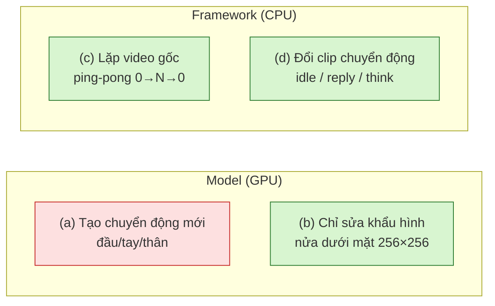
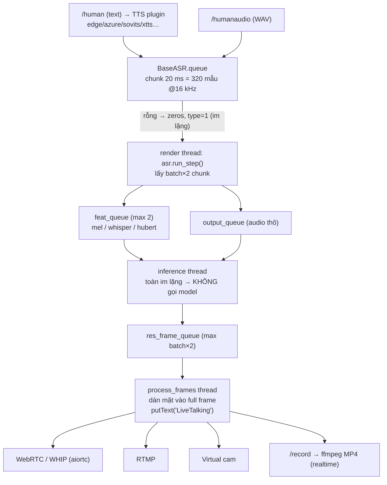
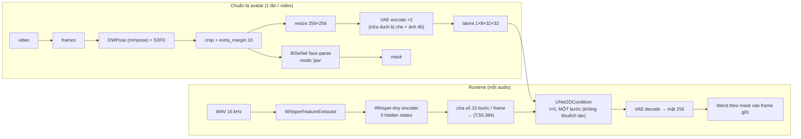

# Phase 0.1 — Nghiên cứu source: LiveTalking & MuseTalk 1.5

> Trạng thái: **nghiên cứu source xong (2026-11-03)**. Chưa cài môi trường engine, chưa tải model, chưa chạy GPU (máy đang phát LIVE bằng OBS). Mọi số FPS/VRAM trong tài liệu này là **số do tác giả công bố hoặc ước lượng**, không phải số đo trên RTX 3060 của chúng ta.
> Ký hiệu: ✅ đã đọc trong source (có trích `file:dòng`) · 🔶 suy luận/ước lượng, cần đo · ⚠️ rủi ro.

## 0. Phiên bản được phân tích

| Repo | Commit | Ngày | License code | Vị trí clone |
|---|---|---|---|---|
| [lipku/LiveTalking](https://github.com/lipku/LiveTalking) | `c7269433a2b6ecebcd9342445d2ecc882c98b0da` | 2026-10-20 | Apache-2.0 ✅ | `F:\Coder\phase0_vendor\LiveTalking` |
| [TMElyralab/MuseTalk](https://github.com/TMElyralab/MuseTalk) | `0a89dec45a0192b824e3cf4daf96c239440c5ed8` | 2025-09-26 | MIT ✅ | `F:\Coder\phase0_vendor\MuseTalk` |

Hai repo được clone **ngoài** monorepo (shallow, `--depth 1`) để không sửa upstream; mọi thay đổi sau này đi qua adapter/fork.

## 1. Kết luận ngắn (đọc phần này trước)

1. **Cả hai engine chỉ vẽ lại vùng miệng/nửa dưới khuôn mặt.** Không engine nào tạo chuyển động đầu/tay/cơ thể mới. Chuyển động trong livestream = **phát lại video gốc** (ping-pong) hoặc **chuyển sang clip quay sẵn**. ✅
2. **LiveTalking có tích hợp MuseTalk 1.5 — nhưng là bản lai (hybrid).** UNet `musetalkV15/unet.pth`, VAE, Whisper, `extra_margin`, mask `jaw` đều đúng 1.5; riêng bước dò landmark đổi từ **DWPose → dlib (`face_recognition`)** và cửa sổ audio viết lại cho streaming. → Không gọi là "MuseTalk 1.5 chính thức"; benchmark công bằng cần chạy **MuseTalk 1.5 standalone** song song. ✅
3. **Wav2Lip256 của LiveTalking không phải checkpoint Wav2Lip chính thức** (bản gốc 96 px). File `wav2lip256.pth` do tác giả LiveTalking phân phối qua Quark/Google Drive, **không ghi nguồn dữ liệu train và license weights**. ⚠️
4. **LiveTalking không có chế độ render offline.** Chỉ có ghi MP4 **theo thời gian thực** (`/record`). MuseTalk có `scripts/inference.py` render offline ra MP4.
5. **Ràng buộc watermark:** README LiveTalking yêu cầu video phát hành trên Douyin/Bilibili… phải mang watermark "LiveTalking", và code **in chữ "LiveTalking" lên mọi frame**. Với TikTok LIVE thương mại đây là rủi ro pháp lý/thương hiệu cần quyết định. ⚠️
6. **Hiệu năng công bố:** wav2lip256 = 60 FPS trên RTX 3060; MuseTalk = 42 FPS trên 3080Ti, khuyến nghị "3080Ti trở lên". 🔶 MuseTalk trên 3060 có nguy cơ **dưới 25 FPS** — phải đo.

## 2. Bốn loại "chuyển động" — không được nhầm

| Khả năng | LiveTalking (OSS) | MuseTalk 1.5 | Bằng chứng |
|---|---|---|---|
| (a) Model tạo chuyển động mới | ❌ | ❌ | Cả 3 model của LT chỉ inpaint vùng crop mặt; MuseTalk README:32 "face region of 256 x 256" ✅ |
| (b) Model chỉ thay khẩu hình | ✅ wav2lip, musetalk, ultralight | ✅ | wav2lip che nửa dưới `wav2lip_avatar.py:128`; MuseTalk mask nửa dưới `models/vae.py:96-97`, `blending.py:112` (`upper_boundary_ratio=0.5`) ✅ |
| (c) Framework lặp video gốc | ✅ `mirror_index` (ping-pong) `utils/image.py:26-32` | ✅ ping-pong "nướng" vào cache `realtime_inference.py:184-186` | ✅ |
| (d) Framework đổi clip chuyển động | ✅ `custom_config.json` + `POST /set_audiotype` (`base_avatar.py:198-210, 311-318`) — clip phát **không lip-sync** | ❌ không có | ✅ |
| "Adaptive actions" (chuyển động tự thích ứng) | ❌ chỉ có ở bản **thương mại** (README:231) | ❌ | ✅ |

**Hệ quả cho mục tiêu "quay 30–60 giây → livestream nhiều giờ":** khả thi về mặt kỹ thuật **chỉ theo kiểu (b)+(c)/(d)**: nhân vật nói câu mới bằng khẩu hình sinh mới, còn cơ thể lặp lại chuyển động của 60 giây gốc. Ping-pong có nhược điểm: các động tác có hướng (vẫy tay, cầm sản phẩm lên) sẽ **chạy ngược** ở nửa sau chu kỳ. Phần "chuyển động tự nhiên nhiều giờ" phải do chúng ta tự làm ở tầng framework (đồ thị clip, chọn điểm cắt, crossfade) — xem §8.

## 3. Kiến trúc LiveTalking

| Thành phần | Chi tiết | Nguồn |
|---|---|---|
| FPS | **Cố định 25** (`--fps … must be 25`), video ptime 40 ms, audio 20 ms | `config.py:51`, `server/webrtc.py:31-33`, `streamout/rtmp.py:87` ✅ |
| Ánh xạ audio→video | 1 frame (40 ms) = 2 chunk 20 ms; mỗi bước xử lý `batch_size×2` chunk | `base_avatar.py:67, 347, 375` ✅ |
| Batch | mặc định 16 (= 640 ms) | `config.py:65` ✅ |
| Ngữ cảnh audio | `-l 10 -r 10` chunk → nhìn trước 200 ms | `config.py:52-54` ✅ |
| Đồng bộ A/V | Mỗi frame video đẩy kèm đúng 2 chunk audio của nó; WebRTC đóng dấu thời gian theo đồng hồ thực | `base_avatar.py:452-461`, `webrtc.py:73-109` ✅ |
| Back-pressure | `feat_queue`=2, `res_frame_queue`=2×batch, render ngủ khi output ≥ 5 | `base_avatar.py:491-494` ✅ |
| Preload | model + avatar mặc định + warm-up lúc khởi động; avatar khác nạp lần đầu rồi cache trong `global_avatars`; mọi frame/mask/latent giữ trong RAM | `app.py:63, 84-91, 143-154`, `utils/image.py:14-24` ✅ |
| Im lặng | Batch toàn im lặng → bỏ qua model, hiện frame gốc (hoặc clip idle tùy chỉnh) | `base_avatar.py:356-360, 412-417` ✅ |
| Chuyển im lặng→nói | Nếu có clip idle tùy chỉnh thì reset `index = 0`; crossfade có code nhưng **tắt** (`enable_transition = False`) | `base_avatar.py:362-363, 384` ✅ ⚠️ nguy cơ nháy hình |
| Ngắt lời | `flush_talk` xóa hàng đợi TTS/ASR, nhưng frame đã nằm trong queue vẫn phát 🔶 | `base_avatar.py:185-190` |

**Độ trễ ước lượng** 🔶: nhìn trước 200 ms + batch 640 ms + queue tới ~1,28 s + thời gian TTS → **khoảng 1–2,5 s** từ lúc có audio tới lúc thấy miệng cử động. Cần đo thật ở Phase 0.7.

### 3.1 Tạo avatar từ video (LiveTalking)

| | wav2lip (`avatars/wav2lip/genavatar.py`) | musetalk (`avatars/musetalk/genavatar.py`) | ultralight |
|---|---|---|---|
| Dò mặt | S3FD (`face_detection`) | S3FD bbox + **dlib** landmark 68 điểm | SCRFD + PFLD |
| Kích thước crop | ⚠️ CLI mặc định **96**, API mặc định 256 → **phải truyền `--img_size 256`** cho model 256 | cố định 256×256 | 168 (dùng 160) |
| File cache | `full_imgs/`, `face_imgs/`, `coords.pkl` | `full_imgs/`, `mask/`, `coords.pkl`, `mask_coords.pkl`, `latents.pt`, `avator_info.json` | + `ultralight.pth` **train riêng cho từng người** |
| Làm mượt bbox | `get_smoothened_boxes(T=5)` | không | không |
| Bám theo đầu | bbox theo từng frame ✅ | bbox+mask+latent theo từng frame ✅ | theo frame ✅ |

Nguồn: báo cáo agent đã đối chiếu `wav2lip/genavatar.py:50,84-85,119-120,146`, `musetalk/genavatar.py:49,64-81,111-126,140`, `server/avatar_routes.py:79`. ✅

### 3.2 Wav2Lip256

- Class đang dùng: `avatars/wav2lip/models/wav2lip_v2.py` (`models/__init__.py:1`), vào 6 kênh × 256×256 (nửa dưới bị che + ảnh tham chiếu), mel 80×16. ✅
- Checkpoint nạp cứng `./models/wav2lip.pth` (`app.py:148`), warm-up 256 (`app.py:150`). ✅
- Nguồn: README:105-110 — tải `wav2lip256.pth` từ Quark / Google Drive rồi đổi tên. **Không có trên HuggingFace, không có tổng kiểm, không ghi license/dữ liệu train.** ⚠️ Tải từ Google Drive cần người dùng thao tác/đồng ý.
- Ultralight cần **train model riêng cho từng người** (`--checkpoint`) → nằm ngoài phạm vi Phase 0 (không train).

## 4. Kiến trúc MuseTalk 1.5 (chính thức)

| Điểm | Chi tiết | Nguồn |
|---|---|---|
| Bản chất | **Không phải diffusion**, inpainting latent **một bước** | README:51, `realtime_inference.py:364, 275-277` ✅ |
| UNet | kiến trúc từ SD-v1.4, audio vào qua cross-attention | README:49, `models/unet.py:36-45` ✅ |
| VAE | `stabilityai/sd-vae-ft-mse` | `download_weights.sh:27-29` ✅ |
| Audio | HF `openai/whisper-tiny` (không phải `tiny.pt` của openai-whisper) | `audio_processor.py:8-13, 53-54` ✅ |
| Cache avatar | `results/v15/avatars/{id}/`: `full_imgs/`, `mask/`, `coords.pkl`, `mask_coords.pkl`, `latents.pt`, `avator_info.json`; **ping-pong 2N frame** | `realtime_inference.py:63-81, 184-190` ✅ |
| Offline vs realtime | `inference.py`: batch 8, fp16 tùy chọn, parse mặt mỗi frame; `realtime_inference.py`: batch 20, luôn fp16, mask tính trước | ✅ |
| Phụ thuộc DWPose | `preprocessing.py:10-19` import mmpose và **nạp DWPose ngay khi import** → kể cả khi đã có cache vẫn cần mmpose + tốn VRAM | ✅ ⚠️ mmcv/mmpose rất khó cài trên Windows |
| Hạn chế tự nhận | "Jitter … single-frame generation" | README:528 ✅ |

### 4.1 v1.0 khác v1.5 ở code

| Mục | v1 | v15 | Nguồn |
|---|---|---|---|
| UNet | `models/musetalk/pytorch_model.bin` | `models/musetalkV15/unet.pth` | `inference.sh:35-44` ✅ |
| `extra_margin` | không dùng | `y2 += 10` (thêm phần cằm) | `realtime_inference.py:175-178` ✅ |
| Mask | `raw` | `jaw` (+ cheek width 90) | `realtime_inference.py:194-197, 378-384` ✅ |
| `bbox_shift` | theo YAML | ép = 0 | `realtime_inference.py:392-395` ✅ |

⚠️ Bẫy mặc định: `realtime_inference.py` có `--version v15` nhưng `--unet_model_path`/`--unet_config` mặc định lại trỏ **đường dẫn v1** (dòng 321-322) — phải truyền tường minh đường dẫn V15 như `inference.sh`, nếu không sẽ âm thầm chạy UNet v1.

## 5. Quan hệ LiveTalking ↔ MuseTalk 1.5 (trả lời §4.C của đề bài)

| # | Câu hỏi | Trả lời | Bằng chứng |
|---|---|---|---|
| 1 | LiveTalking tích hợp MuseTalk phiên bản nào? | **1.5 về model** (`musetalkV15/unet.pth`, `musetalk.json`), mặc định `version='v15'` | LT `avatars/musetalk/utils/utils.py:15-18`, `genavatar.py:49` ✅ |
| 2 | Có hỗ trợ MuseTalk 1.5 *thực sự*? | **Một phần — bản lai.** Đúng: UNet/VAE/Whisper-tiny/extra_margin/`jaw`/cheek 90. Khác: landmark **dlib thay DWPose** (`preprocessing.py:10-20`), `bbox_shift` không bị ép 0 (`genavatar.py:99`), cửa sổ audio streaming kẹp biên thay vì zero-pad, watermark in vào `full_imgs` (`genavatar.py:31`) | ✅ |
| 3 | Cần sửa gì để thành 1.5 trung thực? | (1) khôi phục DWPose (hoặc DWPose ONNX cho cùng keypoint) trong `preprocessing.py`; (2) ép `bbox_shift=0` khi v15; (3) bỏ `putText` watermark ở genavatar/`base_avatar.py:449`; (4) tùy chọn: zero-pad biên audio như bản gốc; (5) `face_recognition`/dlib đang thiếu trong `requirements.txt` | ✅ / 🔶 (4) |
| 4 | Tái dùng avatar cache được không? | **Được về định dạng**: cùng tên file, cùng pickle, cùng tensor `(1,8,32,32)`. Cache chính thức (đã ping-pong 2N) chép sang LT chạy được (LT ping-pong thêm lần nữa, tốn gấp đôi RAM). Cache LT sang bản chính thức: nạp được nhưng mang watermark và bbox từ dlib | ✅ định dạng / 🔶 chất lượng |
| 5 | Có cần chạy MuseTalk 1.5 độc lập để benchmark công bằng? | **Có.** Chạy 3 cấu hình: `LT-wav2lip256`, `LT-musetalk(hybrid)`, `MuseTalk-1.5-official`. Ghi rõ đâu là pipeline tích hợp, đâu là chính thức | — |

⚠️ Lỗi tiềm ẩn chung cả hai codebase: frame không dò được mặt bị bỏ khỏi danh sách latent nhưng vẫn còn trong danh sách frame/coord → lệch chỉ số. Công cụ kiểm tra đầu vào (Phase 0.2) phải đánh dấu video có frame mất mặt.

## 6. Model cần tải

| File | Dùng cho | Nguồn | Dung lượng | Cần cho Phase 0? |
|---|---|---|---|---|
| `wav2lip256.pth` → `models/wav2lip.pth` | LT wav2lip | Quark / Google Drive (README:105-110) | 🔶 ~200–400 MB (chưa công bố) | ✅ |
| `musetalkV15/unet.pth` + `musetalk.json` | MuseTalk 1.5 (cả LT và chính thức) | HF `TMElyralab/MuseTalk` | 🔶 ~3,4 GB | ✅ |
| `sd-vae/` (`diffusion_pytorch_model.bin` + config) | MuseTalk | HF `stabilityai/sd-vae-ft-mse` | 🔶 ~335 MB | ✅ |
| `whisper/` (whisper-tiny HF) | MuseTalk | HF `openai/whisper-tiny` | 🔶 ~150 MB | ✅ |
| `face-parse-bisent/79999_iter.pth` + `resnet18-5c106cde.pth` | MuseTalk | Google Drive (gdown) / pytorch.org | 🔶 ~53 + 45 MB | ✅ |
| `dwpose/dw-ll_ucoco_384.pth` | MuseTalk chính thức (chuẩn bị avatar) | HF `yzd-v/DWPose` | 🔶 ~400 MB | ✅ (chỉ bản chính thức) |
| `s3fd-619a316812.pth` | dò mặt (cả hai) | tự tải từ adrianbulat.com khi thiếu | 🔶 ~86 MB | ✅ |
| `musetalk/pytorch_model.bin` (v1) | MuseTalk 1.0 | HF | 🔶 ~3,4 GB | ❌ bỏ qua |
| `syncnet/latentsync_syncnet.pt` | chỉ để train | HF `ByteDance/LatentSync` | 🔶 ~1,4 GB | ❌ bỏ qua |
| hubert-large, scrfd, pfld, ultralight per-person | ultralight | — | — | ❌ (cần train riêng) |

**Tổng cần cho Phase 0 ≈ 4,7 GB** 🔶 (không phải hàng chục GB). ⚠️ `download_weights.bat` chính thức tải **toàn bộ** repo `TMElyralab/MuseTalk` (không `--include`) và đặt `HF_ENDPOINT=hf-mirror.com` → **không dùng script đó**; tải chọn lọc đúng file bằng `hf download --include` từ huggingface.co.

## 7. Tương thích môi trường trên máy này

Khảo sát 2026-11-03 23:39:

| Hạng mục | Thực tế máy | LiveTalking yêu cầu | MuseTalk yêu cầu |
|---|---|---|---|
| GPU | RTX 3060 12 GB (WDDM, display) | khuyến nghị 3060+ cho wav2lip256 | khuyến nghị 3080Ti+ (theo LT) |
| Driver / CUDA UMD | 617.42 / CUDA 13.4 | torch 2.9.1 **cu128** | torch 2.0.1 **cu118** |
| CUDA toolkit (nvcc) | **không cài** | không cần (wheel tự mang runtime) | không cần, **trừ** khi mmcv phải build từ source ⚠️ |
| Python | 3.12.16, uv 0.13.6 | 3.12 (README:81) | 3.10 (README:151) |
| FFmpeg | 9.0.2 (gyan.dev essentials) | cần trên PATH | cần (script mặc định trỏ `ffmpeg-4.4-amd64-static/`) |
| Ổ đĩa | F: còn 459 GB | | |
| VRAM đang dùng lúc khảo sát | 4,4 GB / 31% util (OBS + TTS server + app) | | |

Kết luận môi trường:
- **Driver 617 tương thích ngược cả cu118 và cu128** 🔶 → không cần đổi driver, không cài CUDA hệ thống.
- **Hai env uv riêng**: `env-livetalking` (py3.12, torch 2.9.1+cu128) và `env-musetalk` (py3.10, torch 2.0.1+cu118, mmcv 2.0.1). ⚠️ mmcv 2.0.1 không có wheel chính thức cho Windows + torch 2.0 + cu118 ở mọi tổ hợp; phương án dự phòng: (a) mmcv-lite + mmpose chỉ dùng cho bước chuẩn bị, hoặc (b) DWPose qua ONNX Runtime, hoặc (c) WSL2. Chọn khi cài thực tế, ghi lại nguyên nhân.
- ⚠️ **VRAM chia sẻ với LIVE**: khi chạy OBS + TTS server đã chiếm ~4,4 GB → engine chỉ còn ~7,5 GB. Benchmark phải chạy **khi không LIVE**, và ghi VRAM nền trước khi chạy.
- `requirements.txt` của LT thiếu: `face_recognition`/dlib (cần build CMake hoặc wheel có sẵn trên Windows ⚠️), `pyvirtualcam`, `pyaudio`, `rtmp_streaming`.

## 8. Tính năng dùng miễn phí vs phải tự phát triển

| Năng lực | Có sẵn miễn phí | Phải tự làm | Ghi chú |
|---|---|---|---|
| Lip-sync realtime từ audio | ✅ LT wav2lip256 / musetalk | | |
| Tạo avatar từ video tùy ý | ✅ cả hai | | |
| Phát idle khi im lặng | ✅ LT | | |
| Đổi clip chuyển động theo trạng thái | ✅ LT `audiotype` (clip phát không lip-sync) | ✅ lip-sync **trên** clip hành động | |
| Chuyển im lặng↔nói mượt | ❌ (crossfade tắt) | ✅ | |
| Vòng lặp tự nhiên nhiều giờ (không chạy ngược động tác) | ❌ chỉ ping-pong | ✅ đồ thị clip + chọn điểm nối + crossfade | Quan trọng nhất cho "video 60 s → live nhiều giờ" |
| Chuyển động tự thích ứng | ❌ chỉ bản thương mại LT | ✅ (hoặc tìm model sinh motion — ngoài Phase 0) | |
| Render offline nhanh hơn realtime | ✅ MuseTalk `inference.py`; ❌ LT | ✅ adapter cho LT | |
| Không watermark | ✅ MuseTalk; ❌ LT (in cứng) | ✅ bỏ watermark trong fork LT — **cần quyết định pháp lý** | README LT §8 |
| Dò mặt DWPose trên Windows | khó | ✅ có thể cần ONNX | |
| Ngắt lời tức thì (xóa frame đã sinh) | ❌ một phần | ✅ | |

## 9. Rủi ro kỹ thuật

| # | Rủi ro | Mức | Giảm thiểu |
|---|---|---|---|
| R1 | MuseTalk trên 3060 < 25 FPS (LT công bố 42 FPS trên 3080Ti; 3060 có ~45% FP16 throughput của 3080Ti 🔶 → ~18–22 FPS) | Cao | Đo thật; thử batch/fp16/TensorRT; nếu không đạt → PARTIAL |
| R2 | Ping-pong làm động tác tay chạy ngược, lộ rõ khi live nhiều giờ | Cao | Video nguồn ít động tác có hướng; tự xây đồ thị clip ở Phase 1 |
| R3 | Rung/jitter vùng miệng (MuseTalk tự nhận) & viền dán mặt | Trung bình | Đánh giá trực quan side-by-side |
| R4 | Đầu xoay/cúi nhiều → crop sai, méo cằm | Trung bình | Công cụ Phase 0.2 đo yaw/jitter; hướng dẫn quay |
| R5 | License weights: wav2lip256 không rõ nguồn; BiSeNet face-parse train trên CelebAMask-HQ (phi thương mại) 🔶; DWPose train trên dữ liệu có điều khoản nghiên cứu 🔶 | Cao (thương mại) | Ghi rõ trong final report; tìm thay thế trước khi bán |
| R6 | Watermark bắt buộc của LiveTalking | Cao (thương mại) | Dùng LT chỉ để benchmark; sản phẩm dùng runtime riêng hoặc xin phép |
| R7 | mmcv/mmpose/dlib khó cài trên Windows | Trung bình | env riêng, ONNX, WSL2 dự phòng |
| R8 | Lệch chỉ số khi có frame mất mặt (bug chung) | Trung bình | Lọc video ở Phase 0.2; vá trong adapter |
| R9 | Tiếng Việt: Whisper-tiny và mel đều không phụ thuộc ngôn ngữ ở tầng âm học, nhưng model train chủ yếu trên tiếng Anh/Trung 🔶 → khẩu hình thanh điệu/nguyên âm tiếng Việt chưa biết | Trung bình | Bộ 24 câu Phase 0.5 |
| R10 | Chia GPU với OBS/TTS khi LIVE thật | Cao | Đo VRAM nền; test cả khi có OBS chạy |

## 10. Bước tiếp theo đã chuẩn bị

- Công cụ kiểm tra đầu vào: `phase0/tools/validate_video.py` (đã smoke test trên ảnh demo — **không phải căn cứ PASS**).
- Bộ 24 câu tiếng Việt + 5 chuỗi kiểm thử + chuỗi 30 phút: `phase0/testsets/vi_sentences.json`, sinh WAV bằng `phase0/tools/prepare_audio.py`.
- Kế hoạch triển khai và trạng thái: [plan.md](plan.md).
